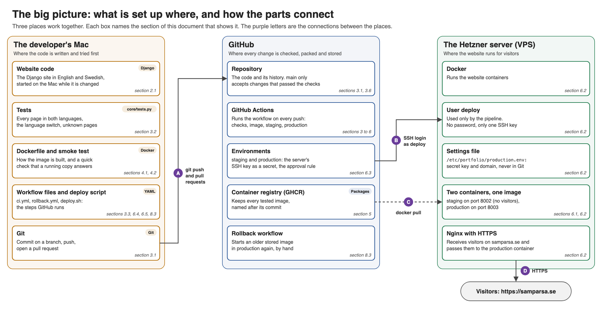
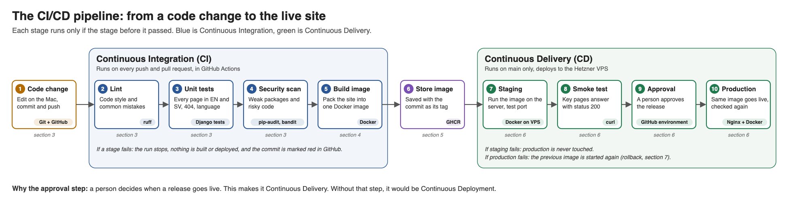

# Portfolio Website CI/CD

A real Django portfolio website ([samparsa.se](https://samparsa.se)) with a full CI/CD pipeline: every change is tested, packed into a Docker image, checked in staging and, after an approval, deployed to a Hetzner server. Built as the final assignment of the course Continuous Integration and Continuous Delivery (DevOps program, Nackademin).



## What It Does



1. **Checks** on every push and pull request: lint (`ruff`), Django tests (every page in English and Swedish), security scans (`pip-audit`, `bandit`, `check --deploy`).
2. **Build:** the site is packed into one Docker image and checked with a smoke test.
3. **Store:** the tested image is saved in GitHub Container Registry, named after its Git commit. Releases also get a version name such as `v1.0.0`.
4. **Staging:** the image runs on the server on a port without visitors and is checked again.
5. **Approval and production:** after a person approves, the same image goes live behind Nginx and is checked a third time.
6. **Rollback:** a separate workflow starts any stored version in production again, without a new build.

## Requirements

- Python 3.11
- Docker (for the image)
- For deployment: a Linux server with Docker, and the GitHub environments `staging` and `production` with the secrets `DEPLOY_SSH_KEY`, `DEPLOY_KNOWN_HOSTS` and the variable `DEPLOY_HOST` (see section 6 of the project record).

## How to Run It

**Development (local machine).** Debug mode is on and no secret settings are needed:

```bash
python3.11 -m venv .venv
.venv/bin/pip install -r requirements-dev.txt
.venv/bin/python manage.py runserver 8010      # http://127.0.0.1:8010
.venv/bin/ruff check                           # lint
.venv/bin/python manage.py test                # tests
```

**The Docker image (local machine).** The same image that runs in production:

```bash
docker build -t portfolio:local .
docker run -d --name portfolio -p 8020:8000 portfolio:local
scripts/smoke_test.sh http://localhost:8020
```

**Production.** Production is never started by hand. A merge into `main` runs the pipeline in `.github/workflows/ci.yml`, which deploys to staging and, after the approval, to production. The production settings (secret key, domain, debug off) come from a settings file that exists only on the server, so they never appear in the code. To go back to an earlier version, run the **Rollback** workflow in the Actions tab with a commit ID or a version such as `v1.0.0`.

## Results

- From a merge to staging: about 1.5 minutes, all automatic.
- A broken change was stopped by the checks before it reached `main`.
- A typo that passed every check was taken off the live site with a rollback: 19 seconds of work on the server, no new build.

## Project Record

The full story, with every step, screenshot and the reasons behind each choice: [project-record/project-record.md](project-record/project-record.md).

## Project Structure

```
.github/workflows/   ci.yml (checks, build, deploy) and rollback.yml
config/, core/       the Django project and app
templates/, static/  pages, styles, images
Swedish Version/     the Swedish texts
scripts/             deploy.sh (runs on the server) and smoke_test.sh
Dockerfile           how the image is built
project-record/      the project record and its images
```
