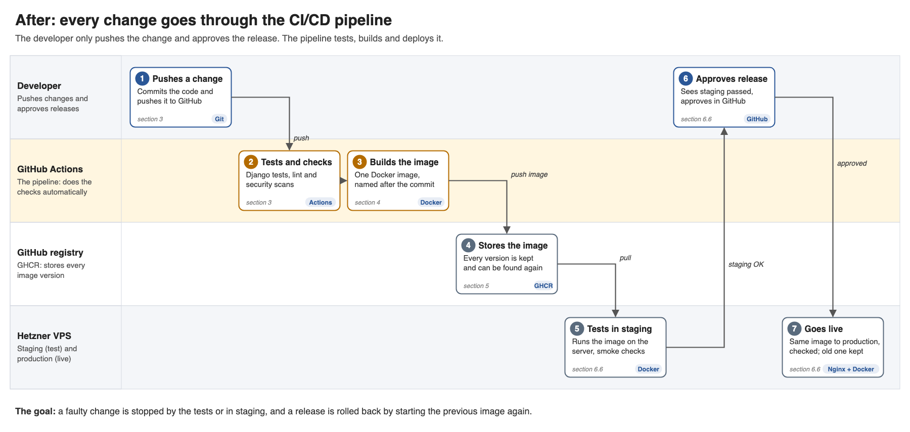
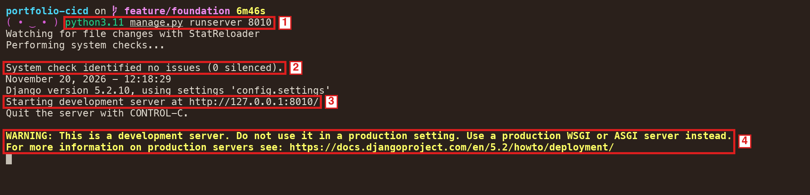

# Portfolio Website CI/CD

This project is the final assignment in the course Continuous Integration and Continuous Delivery (DevOps program, Nackademin). The task is to take a real application and build a full CI/CD pipeline around it. The application chosen here is a real personal portfolio website: a Django application that presents projects, articles and professional experience in English and Swedish.

Before this project, every change to the website was copied to the server by hand. The goal is to make delivery automatic and safe: each change is tested, packaged as a Docker image, checked in a test environment and then deployed to the live server on Hetzner, with a clear way back to an earlier version if something goes wrong. Each step of the pipeline is explained, together with why it exists.

The project is a course assignment, but it is built on a real system: the website is the real portfolio, and the pipeline is meant to stay in use after the course. The solution is therefore sized to the website. It is a small site with no database on one server, so the pipeline aims to be clean, reliable and easy to follow, not a large enterprise setup. Where a real production setup would go further, this is pointed out.

## 1. Before and After: From Manual Updates to a Pipeline

The portfolio website at samparsa.se already runs on a rented server. This section shows in two pictures how an update reaches the live site today, and how it should reach it when the pipeline is in place.

### 1.1 Before: Every Update Goes Straight to the Server

Samuel Parsakian, the developer and owner of the site, does every step of an update by hand. Figure 1 shows the whole update from above. The numbers in the figure match the steps below.

*Figure 1. Before: an update goes from the Mac straight to the live server.*

1. **Changes the code.** The Django site is edited on the Mac.
2. **Copies the files.** The new files are sent to a folder on the server over SSH (a secure connection to the server).
3. **Restarts the site.** Gunicorn, the program that runs the Django code on the server, is restarted so that the new code is used.
4. **Checks the site.** samparsa.se is opened in the browser to see if the pages still look right.

**No checks before release.** There are no automated tests. An error is found only after the update is live, by checking the pages manually in the browser.

**Old versions pile up.** The server holds 9 app folders in `/var/www/`, from `samstack` to `samstack_next7`, and only one of them, `samstack_next4`, is live. The folder names do not say which version of the site each one holds.

**Why is this a problem?**

- **Availability:** a faulty update can make pages or the whole site unavailable until it is fixed by hand.
- **Maintenance:** every update is a series of manual steps on the live server, with no record of what changed or when, and no quick way back to a known working version.

### 1.2 After: Every Change Goes Through the Pipeline

With the pipeline, the developer only pushes the change to GitHub and approves the release. The checks, the build and the deployment run automatically. Figure 2 shows the same update in the new way.

*Figure 2. After: every change goes through tests, a Docker image and a staging test before it goes live.*

1. **Pushes a change.** The code is committed and pushed to GitHub. Every change then has its own commit, so it can be traced later.
2. **Tests and checks.** GitHub Actions (GitHub's built-in automation) runs the Django tests, a code style check (lint) and security scans. They catch errors and known security problems before anything is built.
3. **Builds the image.** Only if every check passes, the site is packed into one Docker image (a ready-to-run package of the site with everything it needs), named after the Git commit. The image runs the same way everywhere, so the version that was tested is exactly the version that goes live.
4. **Stores the image.** The image is saved in the GitHub container registry (GHCR), so every version is kept and the previous one can be started again.
5. **Tests in staging.** The image runs on the server in a separate test copy of the site, called staging, and is checked automatically. A problem shows up there first, not on the live site.
6. **Approves the release.** The developer looks at staging and approves the release in GitHub. A person stays in control of what goes live.
7. **Goes live.** The same image is started in production (the live site) and checked again. The previous image is kept.

**The main difference:** a faulty change is stopped by the tests or in staging, before it reaches production. Rolling back means starting the previous image again.

### 1.3 Before vs. After

| | Before (by hand) | After (CI/CD pipeline) |
|---|---|---|
| **How an update reaches the server** | Files copied by hand over SSH | Pipeline deploys a Docker image |
| **Tests before going live** | **None** | Django tests, lint and security scans on every change |
| **Test environment** | **None**, changes go straight to the live site | Staging on the same server, checked automatically |
| **Versions** | **9 app folders** in `/var/www/`, not labelled | Each image named after its Git commit |
| **Going back to an older version** | Find the right folder and switch by hand | Start the previous image again |
| **Check after an update** | Manual check in the browser | Automated checks on the live pages |

In short, the manual update works, but nothing protects the live site from a faulty change. The pipeline adds the checks, the versions and the way back that are missing today.

## 2. The Starting Point: The Website and the Server

Before anything is automated, the starting point must be clear: what the website is, how it runs on a computer, and how it runs on the live server today. A known working starting point matters, because any later problem can then be compared with it.

### 2.1 The Website Runs on the Mac

The website is a Django application (Django is a Python framework for building websites). It has a few features that keep it simple:

- **No database.** All texts, projects and articles are stored in the code itself, so there is nothing to back up or migrate.
- **Two languages.** English and Swedish. The EN | SV switch in the corner saves the choice in a cookie.
- **Static files** (images, styles, scripts, CV files) are served by WhiteNoise, a small Python package that lets Django serve them itself.

The project is organized in the usual Django way (Figure 3):

1. `config/` holds the project settings (`settings.py`), the main address list (`urls.py`) and `wsgi.py`, the entry point a production server such as Gunicorn uses to start the site.
2. `core/` is the application itself: the pages (`views.py`), their addresses (`urls.py`), the HTML templates, and all texts, projects and articles (`site_data.py` and the two `article_two_rows` files). `locale.py` loads the Swedish texts.
3. `project-record/` is this document and its images. It is part of the project, so the documentation is versioned together with the code.
4. `static/` holds the CSS, JavaScript, images and the CV files in English and Swedish.
5. `Swedish Version/SV-TRANSLATION.txt` holds all Swedish texts in one file.
6. `templates/base.html` is the shared page frame that every page is built on.
7. `manage.py` is Django's command tool, and `requirements.txt` lists the exact Python packages and versions the site needs: Django 5.2.10, django-environ 0.12.0 and WhiteNoise 6.11.0.

*Figure 3. The project folders, opened in VS Code.*

Two more files matter for safety. `.gitignore` keeps local and secret files out of Git, and `.env.example` shows which settings (for example the secret key) must be given from outside, so that no secret is stored in the code.

To prove that the website works from its project folder, it was started with Django's built-in development server (Figure 4):

1. The command `python3.11 manage.py runserver 8010` starts the website on the Mac, on port 8010.
2. Django checks the project first and finds no problems.
3. The website is now reachable at `http://127.0.0.1:8010/`, an address that only works on this Mac.
4. Django warns that this server is only for development. A real website needs a production server such as Gunicorn. This becomes important later, when the Docker image is built.

*Figure 4. The website starts on the Mac with no problems found.*

The home page then opens in the browser (Figure 5):

1. The address is the local one from Figure 4.
2. The language switch shows EN as the active language.

*Figure 5. The home page in English, running on the Mac.*

After a click on SV, the same page is shown in Swedish (Figure 6):

1. The address is still the local one.
2. SV is now the active language.
3. The headings are in Swedish, for example "Om mig" (About me).

*Figure 6. The same home page in Swedish.*

### 2.2 The Live Server Today

The live site runs on a VPS (a rented virtual server) at Hetzner, with Ubuntu 24.04. Two programs work together on it:

- **Nginx** receives all visits to samparsa.se, handles HTTPS, and passes the requests on.
- **Gunicorn** runs the Django code. It is started by systemd, the part of Ubuntu that starts and watches services.

The command `systemctl status gunicorn --no-pager` shows if Gunicorn is running and from where (Figure 7):

1. The command asks systemd for the state of the Gunicorn service.
2. Gunicorn is active and has been running for 5 days.
3. It runs the site from the folder `/var/www/samstack_next4`, one of the 9 app folders from section 1.1.
4. The Gunicorn version is 24.1.1.

*Figure 7. Gunicorn runs the live site from the folder samstack_next4.*

The command `grep -E "server_name|proxy_pass|alias" /etc/nginx/sites-available/samparsa` shows only the three most important lines of the Nginx settings for the site (Figure 8):

1. `server_name`: Nginx answers for samparsa.se and www.samparsa.se.
2. `alias`: the static files are read straight from the same folder, samstack_next4.
3. `proxy_pass`: all other requests are passed to Gunicorn on port 8001 of the server itself.

*Figure 8. Nginx passes visits to Gunicorn and serves the static files from samstack_next4.*

Both Gunicorn and Nginx point at one folder by its name. To put a new version live by hand, both must be changed and restarted, which is exactly the kind of manual step the pipeline removes.

Finally, the live site answers on its real address (Figure 9):

1. The address is https://samparsa.se, served over HTTPS.

*Figure 9. The live site at samparsa.se, the version that runs today.*

The website runs on the Mac without problems, in both languages, and the live server runs the same site through Nginx and Gunicorn. This is the starting point the pipeline is built on.
