# Portfolio Website CI/CD

This project is the final assignment in the course Continuous Integration and Continuous Delivery (DevOps program, Nackademin). The task is to take a real application and build a full CI/CD pipeline around it. The application chosen here is a real personal portfolio website: a Django application that presents projects, articles and professional experience in English and Swedish.

Before this project, every change to the website was copied to the server by hand. The goal is to make delivery automatic and safe: each change is tested, packaged as a Docker image, checked in a test environment and then deployed to the live server on Hetzner, with a clear way back to an earlier version if something goes wrong. Each step of the pipeline is explained, together with why it exists.

The project is a course assignment, but it is built on a real system: the website is the real portfolio, and the pipeline is meant to stay in use after the course. The solution is therefore sized to the website. It is a small site with no database on one server, so the pipeline aims to be clean, reliable and easy to follow, not a large enterprise setup. Where a real production setup would go further, this is pointed out.

## 1. Before and After: From Manual Updates to a Pipeline

The portfolio website at samparsa.se already runs on a rented server. This section shows in two pictures how an update reaches the live site today, and how it should reach it when the pipeline is in place.

### 1.1 Before: Every Update Goes Straight to the Server

Samuel, the developer and owner of the site, does every step of an update by hand. Figure 1 shows the whole update from above. The numbers in the figure match the steps below.

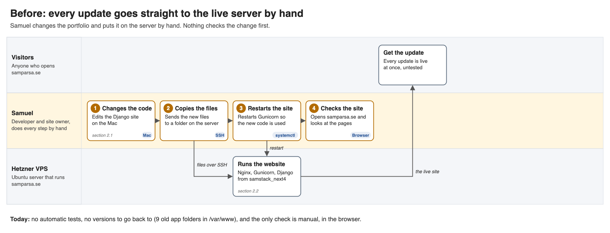

*Figure 1. Before: an update goes from the Mac straight to the live server.*

1. **Changes the code.** The Django site is edited on the Mac.
2. **Copies the files.** The new files are sent to a folder on the server over SSH (a secure connection to the server).
3. **Restarts the site.** Gunicorn, the program that runs the Django code on the server, is restarted so that the new code is used.
4. **Checks the site.** samparsa.se is opened in the browser to see if the pages still look right.

**No checks before release.** There are no automated tests. An error is found only after the update is live, by checking the pages manually in the browser.

**Old versions pile up.** The server holds 9 app folders in `/var/www/`, from `samstack` to `samstack_next7`, and only one of them, `samstack_next4`, is live. The folder names do not say which version of the site each one holds.

**Why is this a problem?**

- **Availability:** a faulty update can make pages or the whole site unavailable until it is fixed by hand.
- **Maintenance:** every update is a series of manual steps on the live server, with no record of what changed or when, and no quick way back to a known working version.

### 1.2 After: Every Change Goes Through the Pipeline

With the pipeline, the developer only pushes the change to GitHub and approves the release. The checks, the build and the deployment run automatically. Figure 2 shows the same update in the new way.

*Figure 2. After: every change goes through tests, a Docker image and a staging test before it goes live.*

1. **Pushes a change.** The code is committed and pushed to GitHub. Every change then has its own commit, so it can be traced later.
2. **Tests and checks.** GitHub Actions (GitHub's built-in automation) runs the Django tests, a code style check (lint) and security scans. They catch errors and known security problems before anything is built.
3. **Builds the image.** Only if every check passes, the site is packed into one Docker image (a ready-to-run package of the site with everything it needs), named after the Git commit. The image runs the same way everywhere, so the version that was tested is exactly the version that goes live.
4. **Stores the image.** The image is saved in the GitHub container registry (GHCR), so every version is kept and the previous one can be started again.
5. **Tests in staging.** The image runs on the server in a separate test copy of the site, called staging, and is checked automatically. A problem shows up there first, not on the live site.
6. **Approves the release.** The developer sees that staging passed its checks and approves the release in GitHub. A person stays in control of what goes live.
7. **Goes live.** The same image is started in production (the live site) and checked again. The previous image is kept.

Figure 3 shows the same pipeline in the usual CI/CD form, as one line of stages. The blue part is Continuous Integration (CI): it checks and packs every change. The green part is Continuous Delivery (CD): it takes the packed change to the server. The table below follows the same numbers.

*Figure 3. The pipeline stages: CI in blue, the stored image in purple, CD in green.*

| Stage | What it does | Why it is there |
|---|---|---|
| 1. Code change | The change is committed and pushed to GitHub | The push starts the pipeline, and the commit makes the change traceable |
| 2. Lint | `ruff` checks code style and common mistakes | Simple errors are caught in seconds, before the slower stages run |
| 3. Unit tests | Django tests open every page in English and Swedish | A broken page or language switch is found before it can reach the server |
| 4. Security scan | `pip-audit` checks the packages, `bandit` checks the code | Known security holes are found before they are deployed |
| 5. Build image | The site is packed into one Docker image | The tested code and everything it needs travel as one unit |
| 6. Store image | The image is saved in GHCR, tagged with the commit | Every version is kept and can be traced back to its commit |
| 7. Staging | The image runs on the server on a test port | The release is tried on the real server, without visitors |
| 8. Smoke test | The key pages are requested and must answer with status 200 | Proof that the release really works on the server |
| 9. Approval | A person approves the release in GitHub | The decision to go live stays with a person |
| 10. Production | The same image goes live and is checked again | The live site gets exactly the version that passed staging |

**The main difference:** a faulty change is stopped by the tests or in staging, before it reaches production. Rolling back means starting the previous image again.

### 1.3 Before vs. After

| | Before (by hand) | After (CI/CD pipeline) |
|---|---|---|
| **How an update reaches the server** | Files copied by hand over SSH | Pipeline deploys a Docker image |
| **Tests before going live** | **None** | Django tests, lint and security scans on every change |
| **Test environment** | **None**, changes go straight to the live site | Staging on the same server, checked automatically |
| **Versions** | **9 app folders** in `/var/www/`, not labelled | Each image named after its Git commit |
| **Going back to an older version** | Find the right folder and switch by hand | Start the previous image again |
| **Check after an update** | Manual check in the browser | Automated checks on the live pages |

In short, the manual update works, but nothing protects the live site from a faulty change. The pipeline adds the checks, the versions and the way back that are missing today.

## 2. The Starting Point: The Website and the Server

Before anything is automated, the starting point must be clear: what the website is, how it runs on a computer, and how it runs on the live server today. A known working starting point matters, because any later problem can then be compared with it.

### 2.1 The Website Runs on the Mac

The website is a Django application (Django is a Python framework for building websites). It has a few features that keep it simple:

- **No database.** All texts, projects and articles are stored in the code itself, so there is nothing to back up or migrate.
- **Two languages.** English and Swedish. The EN | SV switch in the corner saves the choice in a cookie.
- **Static files** (images, styles, scripts, CV files) are served by WhiteNoise, a small Python package that lets Django serve them itself.

The project is organized in the usual Django way (Figure 4):

1. `config/` holds the project settings (`settings.py`), the main address list (`urls.py`) and `wsgi.py`, the entry point a production server such as Gunicorn uses to start the site.
2. `core/` is the application itself: the pages (`views.py`), their addresses (`urls.py`), the HTML templates, and all texts, projects and articles (`site_data.py` and the two `article_two_rows` files). `locale.py` loads the Swedish texts.
3. `project-record/` is this document and its images. It is part of the project, so the documentation is versioned together with the code.
4. `static/` holds the CSS, JavaScript, images and the CV files in English and Swedish.
5. `Swedish Version/SV-TRANSLATION.txt` holds all Swedish texts in one file.
6. `templates/base.html` is the shared page frame that every page is built on.
7. `manage.py` is Django's command tool, and `requirements.txt` lists the exact Python packages and versions the site needs: Django 5.2.10, django-environ 0.12.0 and WhiteNoise 6.11.0.

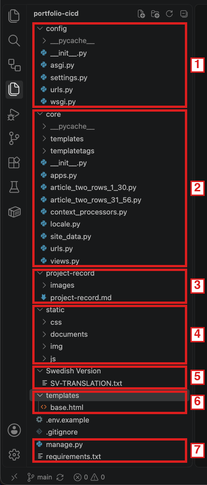

*Figure 4. The project folders, opened in VS Code.*

Two more files matter for safety. `.gitignore` keeps local and secret files out of Git, and `.env.example` shows which settings (for example the secret key) must be given from outside, so that no secret is stored in the code.

To prove that the website works from its project folder, it was started with Django's built-in development server (Figure 5):

1. The command `python3.11 manage.py runserver 8010` starts the website on the Mac, on port 8010.
2. Django checks the project first and finds no problems.
3. The website is now reachable at `http://127.0.0.1:8010/`, an address that only works on this Mac.
4. Django warns that this server is only for development. A real website needs a production server such as Gunicorn. This becomes important later, when the Docker image is built.

*Figure 5. The website starts on the Mac with no problems found.*

The home page then opens in the browser (Figure 6):

1. The address is the local one from Figure 5.
2. The language switch shows EN as the active language.

*Figure 6. The home page in English, running on the Mac.*

After a click on SV, the same page is shown in Swedish (Figure 7):

1. The address is still the local one.
2. SV is now the active language.
3. The headings are in Swedish, for example "Om mig" (About me).

*Figure 7. The same home page in Swedish.*

### 2.2 The Live Server Today

The live site runs on a VPS (a rented virtual server) at Hetzner, with Ubuntu 24.04. Two programs work together on it:

- **Nginx** receives all visits to samparsa.se, handles HTTPS, and passes the requests on.
- **Gunicorn** runs the Django code. It is started by systemd, the part of Ubuntu that starts and watches services.

The command `systemctl status gunicorn --no-pager` shows if Gunicorn is running and from where (Figure 8):

1. The command asks systemd for the state of the Gunicorn service.
2. Gunicorn is active and has been running for 5 days.
3. It runs the site from the folder `/var/www/samstack_next4`, one of the 9 app folders from section 1.1.
4. The Gunicorn version is 24.1.1.

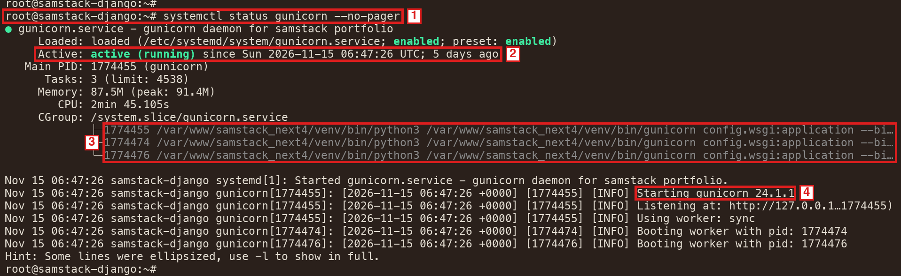

*Figure 8. Gunicorn runs the live site from the folder samstack_next4.*

The command `grep -E "server_name|proxy_pass|alias" /etc/nginx/sites-available/samparsa` shows only the three most important lines of the Nginx settings for the site (Figure 9):

1. `server_name`: Nginx answers for samparsa.se and www.samparsa.se.
2. `alias`: the static files are read straight from the same folder, samstack_next4.
3. `proxy_pass`: all other requests are passed to Gunicorn on port 8001 of the server itself.

*Figure 9. Nginx passes visits to Gunicorn and serves the static files from samstack_next4.*

Both Gunicorn and Nginx point at one folder by its name. To put a new version live by hand, both must be changed and restarted, which is exactly the kind of manual step the pipeline removes.

Finally, the live site answers on its real address (Figure 10):

1. The address is https://samparsa.se, served over HTTPS.

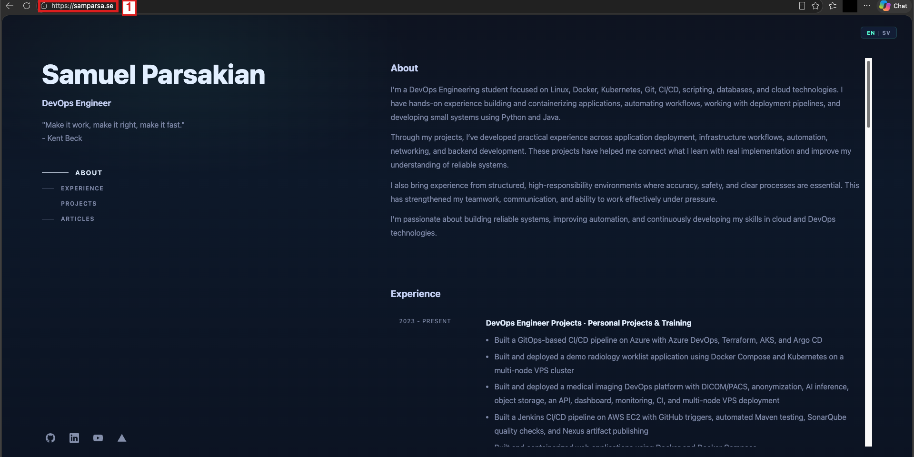

*Figure 10. The live site at samparsa.se, the version that runs today.*

The website runs on the Mac without problems, in both languages, and the live server runs the same site through Nginx and Gunicorn. This is the starting point the pipeline is built on.

## 3. Continuous Integration: Every Change Is Checked Automatically

With the starting point clear, the first part of the pipeline can be built: Continuous Integration (CI). CI means that every change is checked automatically as soon as it is pushed, so mistakes are found early, while they are still small and cheap to fix.

### 3.1 The Repository: One Place for All Changes

**What was done.** The project was put under version control with Git and pushed to a new private repository on GitHub, `portfolio-cicd`.

**Why it was needed.** Before, the only copies of the site were on the Mac and in the folders on the server. A pipeline needs one shared place where every change arrives, so that it can react to each change.

**What it solves.** Every change now has a commit: who changed what, when and why. This is the base of traceability: later, every Docker image and every deployment can be traced back to a commit.

The repository is connected and the code is pushed from the terminal (Figure 11):

1. `git remote add origin ...` tells Git where the GitHub repository is.
2. `git push -u origin main feature/foundation` sends the two branches to GitHub.
3. GitHub confirms that both branches were created.

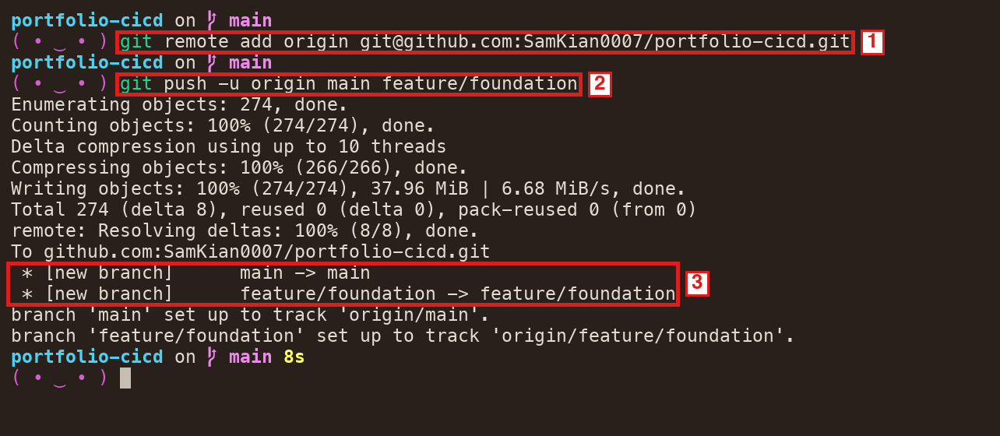

*Figure 11. The code is pushed to the new repository.*

The repository on GitHub then shows the code (Figure 12):

1. The repository `portfolio-cicd` is private.
2. Two branches: `main`, the stable version, and `feature/foundation`, where the first work was done. New work always happens on its own branch and is merged into `main` only when it is finished.
3. The latest commit on `main`, with its short ID (`2ec7ead`). This ID is how a version is identified later.
4. A short description of the project.

*Figure 12. The private repository on GitHub with the code and its history.*

### 3.2 What Is Tested: The Tests

The goal of the tests in `core/tests.py` is to prove, after every change, that the whole site still works: every page opens in both languages, the language switch works and cannot be misused, project pages show their own screenshots, and a wrong address answers "not found" instead of crashing the server. Before, the only check was to open a few pages in a browser by hand, which was slow, easy to skip and never complete. Now all 74 pages are checked automatically, so a broken page is stopped before it reaches the live site. The tests use Django's own test tools, so no extra framework is needed. Each test requests a page and compares the real answer with the expected one: the status code must be 200, the Swedish page must contain the heading "Om mig", the language switch must lead back to `/`. Any difference fails the test. The requests go straight to the Django code in memory, with no browser, network or database, which is why all 10 tests finish in well under a second.

The start of the file prepares the list of pages (Figure 13):

1. A short description of what the file does. The site has no database, so every test is a `SimpleTestCase`, the lightest kind of Django test.
2. `PROJECTS_WITH_PAGES` finds every project that has screenshots, because only those have a detail page and a gallery page.
3. `all_page_urls()` builds the full list of addresses: the main pages, the articles, and each project's detail and gallery pages. That is 37 addresses.

*Figure 13. `core/tests.py`, part 1: the list of every page on the site.*

The first two groups of tests check the pages and the language switch (Figure 14):

1. Every one of the 37 pages must open in English with status 200.
2. The same test runs again with the language cookie set to Swedish. Together that is 74 pages.
3. The switch to Swedish must send the visitor back to the page they came from and save the choice in a cookie.

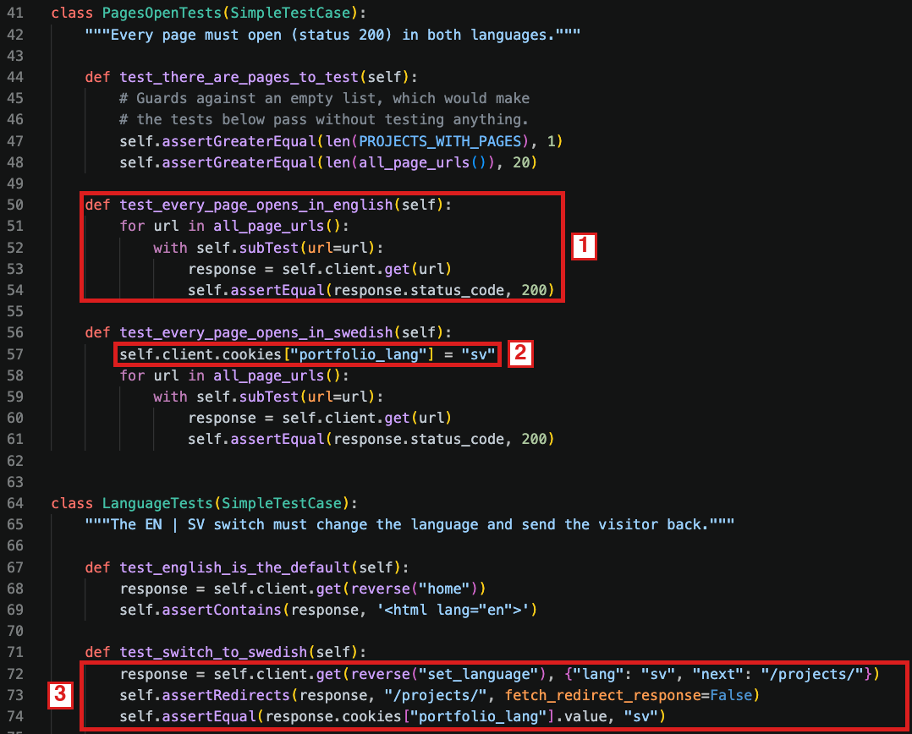

*Figure 14. `core/tests.py`, part 2: every page in both languages, and the language switch.*

The next tests check the Swedish text and the safety of the switch (Figure 15):

1. After the switch, the home page must really be in Swedish, with the heading "Om mig".
2. The switch must never send a visitor to another website, even if someone builds a link that asks for it. This becomes important in section 3.4.
3. A project page must show the project's own screenshots.

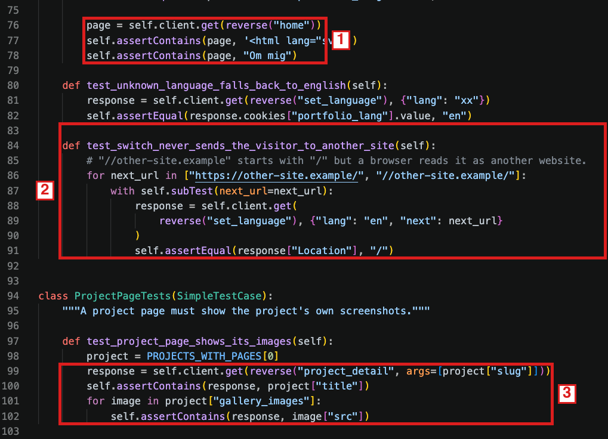

*Figure 15. `core/tests.py`, part 3: Swedish text, a safe language switch and the project images.*

The last group checks what happens with a wrong address (Figure 16):

1. An unknown page and an unknown project must answer 404 (not found). If they answered 500, it would mean that the server crashed.

*Figure 16. `core/tests.py`, part 4: wrong addresses answer "not found".*

### 3.3 How the Pipeline Is Configured: The Tools and the Workflow

**What was done.** Three check tools were chosen and a GitHub Actions workflow was written that runs them, together with the tests, on every push.

**Why it was needed.** Tests check that the site works. They do not check code quality or security. Each tool covers one more kind of risk.

**What it solves.** Problems in style, in the packages and in the production settings are found before anything is deployed.

| Tool | What it checks | Risk it reduces |
|---|---|---|
| `ruff` (lint) | Code style and common mistakes, for example an unused import | Messy code that hides real bugs |
| `pip-audit` | The Python packages in `requirements.txt` against a public list of known security holes | Running a package that attackers already know how to break |
| `bandit` | The project's own code for risky patterns, for example a password written in the code | Security mistakes in the code itself |
| `manage.py check --deploy` | Django's own check of the production settings | A live site with unsafe settings, for example debug mode left on |

The packages the website needs are listed with exact versions in `requirements.txt` (Figure 17):

1. Django, the framework, at version 5.2.10. This exact version becomes important in section 3.4.
2. django-environ reads the settings from the environment, and WhiteNoise serves the static files.

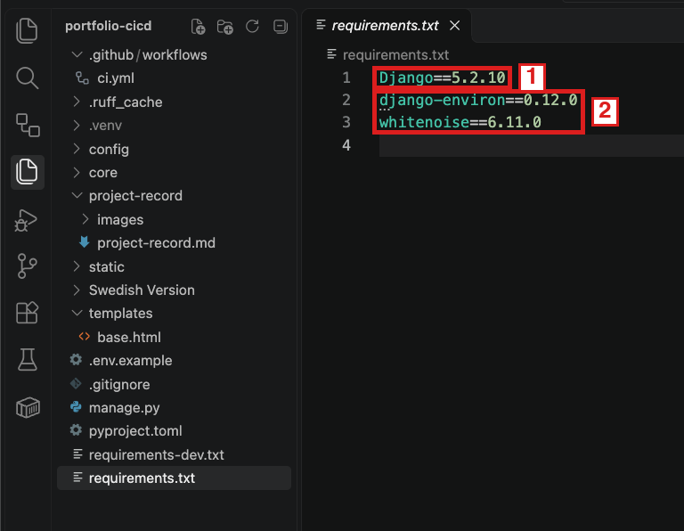

*Figure 17. `requirements.txt`: the exact package versions the website runs on.*

The check tools are kept in a separate file, `requirements-dev.txt`, because the live website does not need them (Figure 18):

1. The line `-r requirements.txt` includes the website's own packages, so the tests run against exactly the same versions.
2. The three check tools, each with an exact version, so the checks behave the same on every run.

*Figure 18. `requirements-dev.txt`: the tools used only by the pipeline.*

A GitHub Actions workflow is a file in `.github/workflows/` that tells GitHub what to run and when. GitHub starts a fresh Ubuntu machine (a "runner") for each job, runs the steps, and throws the machine away afterwards. The first part of `ci.yml` sets the rules and the first job (Figure 19):

1. `on: push` and `pull_request`: the workflow runs on every push to any branch and on every pull request.
2. `permissions: contents: read`: the workflow may only read the code. It cannot change anything in the repository, which limits the damage if a tool were ever compromised.
3. Python 3.11 is installed, the same version as on the Mac. `cache: pip` keeps the downloaded packages between runs, so later runs are faster.
4. The lint job runs `ruff check .` on the whole project.
5. The test job starts. Each job runs on its own fresh machine.

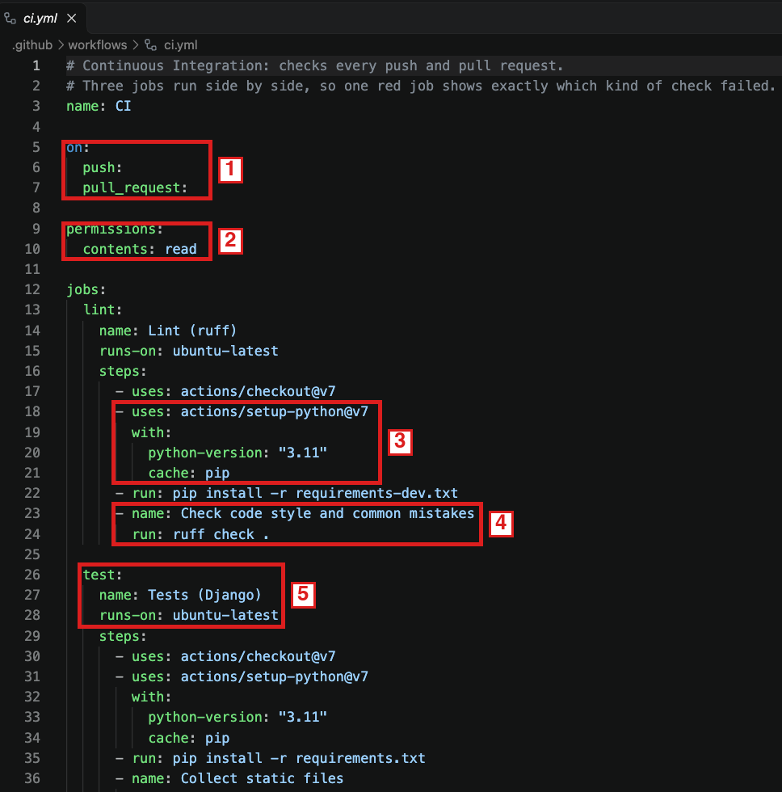

*Figure 19. `.github/workflows/ci.yml`, part 1: when the workflow runs, and the lint job.*

The rest of the file holds the test job and the security job (Figure 20):

1. `collectstatic` gathers all static files, the same step the live server needs. If a file were missing, this step would fail.
2. `python manage.py test` runs all the tests from section 3.2.
3. `pip-audit` checks the website's packages for known security holes.
4. `bandit` checks the code in `core` and `config` for risky patterns.
5. Django's deploy check runs with production settings: debug off, the real domain, and a random secret key made only for this run, so no real secret is ever stored in the workflow.

*Figure 20. `.github/workflows/ci.yml`, part 2: the test job and the security job.*

The three jobs (lint, tests, security) run side by side. This is faster than one long job, and when a run fails, the red job shows at once which kind of check found the problem.

### 3.4 The First Run: The Pipeline Finds Real Problems

The workflow ran for the first time as soon as it was pushed. All three jobs failed. The problems were already in the code and packages of the live website. They had simply never been checked before.

The summary of the run shows the result at a glance (Figure 21):

1. The run was started by a push of commit `940b020` to the branch `feature/ci`. This link between a run and a commit is what makes every result traceable.
2. Status: Failure, after 38 seconds.
3. All three jobs are red. Because they run side by side, each one reports its own problem.
4. Each job ends with "exit code 1", which is how a tool tells GitHub that its check failed.

*Figure 21. The first run of the workflow: all three jobs failed.*

**Lint: 8 code style problems.** Ruff listed every problem with the file, the line and a suggested fix (Figure 22):

1. The failed step, "Check code style and common mistakes".
2. One of the problems: `get_ui` is imported in `core/views.py` but never used. Ruff also shows the fix: remove it from the import line.
3. "Found 8 errors". Six of them ruff can fix by itself, marked `[*]`.

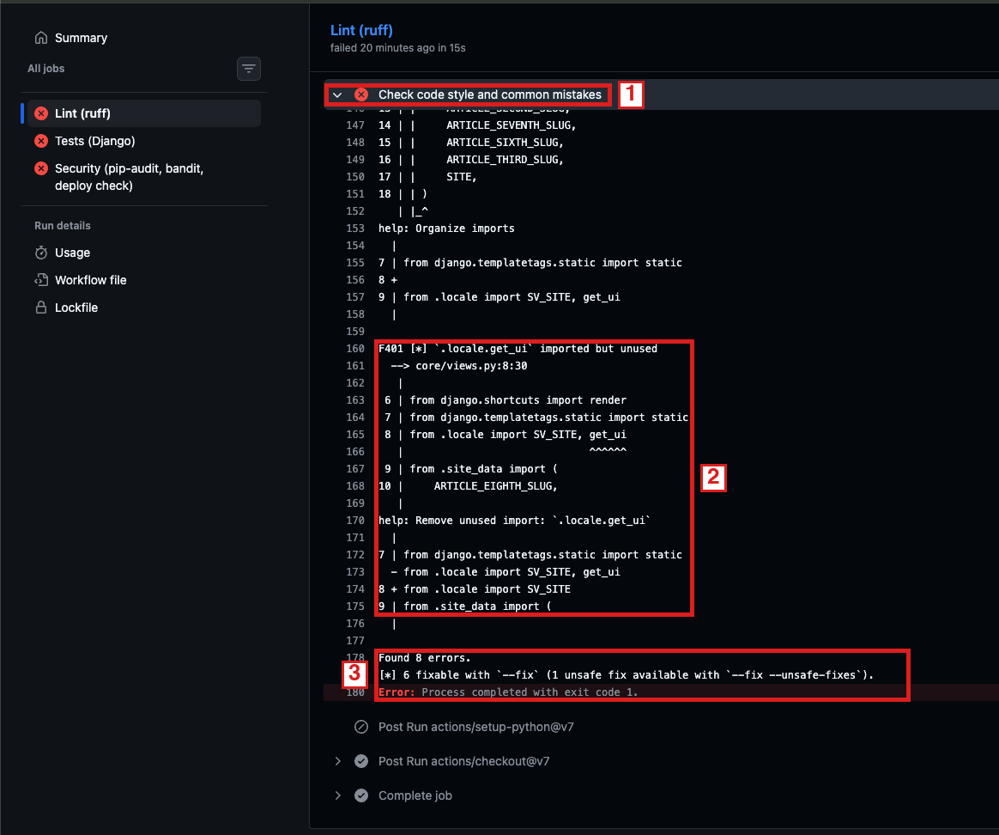

*Figure 22. The lint job: ruff found 8 problems in the code.*

**Tests: the language switch could send visitors to another website.** Nine of the ten tests passed. The failing one is the safety test from section 3.2 (Figure 23):

1. The failed step, "Run the tests".
2. The other tests passed, so every page opens in both languages.
3. The failure: the test expected the switch to lead back to `/`, but it led to `//other-site.example/`. A link like that starts with `/`, so the old code accepted it as a page on this site, but a browser reads it as another website. Someone could use it to send a visitor from samparsa.se to a fake site. This kind of hole is called an open redirect.
4. "Ran 10 tests in 0.296s", "FAILED (failures=1)".

*Figure 23. The test job: the language switch failed the safety test.*

**Security: Django 5.2.10 had known security holes.** pip-audit compared the installed packages with a public list of known security holes (Figure 24):

1. The failed step, "Check the packages for known security holes".
2. The end of the list. In total, pip-audit reported "Found 51 known vulnerabilities in 1 package", all in Django 5.2.10. The last column shows the versions where each hole is fixed.
3. Because this step failed, the next two checks (bandit and the deploy check) did not run at all.

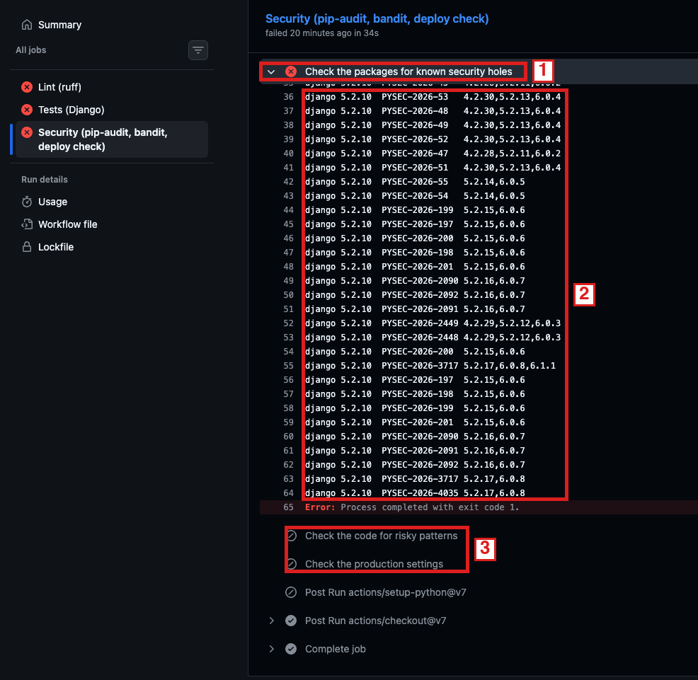

*Figure 24. The security job: pip-audit found known security holes in Django 5.2.10.*

### 3.5 Fixing the Findings: One Fix for Each Problem

Each finding from section 3.4 got its own small fix, in its own commit, so every change can be traced back to the problem it solves.

**Problem 1: code style.** Ruff found 8 problems. *Solution: follow ruff's suggestions.* Six of the fixes were the ones ruff offered itself (Figure 22): imports sorted in four files, the unused `get_ui` import removed, and an old comment marker that was no longer needed. The last two were changed by hand: a loop in `core/locale.py` now reads only the values it uses, and a too-broad `except Exception` in `core/templatetags/locale_extras.py` now catches only the two errors that can really happen there (`TypeError`, `ValueError`). The behavior of the site did not change.

**Problem 2: the open redirect.** The switch trusted any address that started with `/`. *Solution: use Django's own safety check.* Instead of a home-made rule, the switch now asks Django whether the address really belongs to this site (Figure 25):

1. The check is imported from Django: `url_has_allowed_host_and_scheme`.
2. If the address points anywhere other than this site, the visitor is sent to the home page `/` instead.

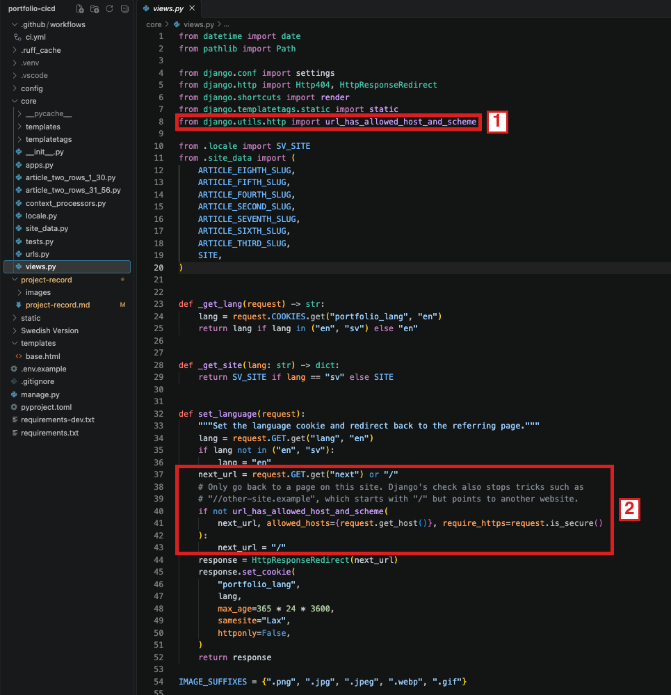

*Figure 25. `core/views.py`: the language switch now only goes back to pages on this site.*

**Problem 3: known security holes in Django.** *Solution: update Django to the latest 5.2 version.* Version 5.2.19 fixes all the reported holes. It is still in the same 5.2 series, a long-term support version, so the update brings fixes but no breaking changes (Figure 26):

1. `Django==5.2.19` instead of `5.2.10`.

*Figure 26. `requirements.txt`: Django updated to 5.2.19.*

Before pushing, the same checks were run on the Mac: ruff reported "All checks passed!", all 10 tests passed, pip-audit reported "No known vulnerabilities found", and the deploy check found no issues.

### 3.6 The Second Run: Green, and Only Green Code Reaches main

After the three fixes were pushed, the workflow ran again by itself. The list of runs now tells the whole story (Figure 27):

1. Run #1, commit `940b020`: failed.
2. Run #2, commit `9c2c9cf`, the Django update: passed.

*Figure 27. The list of runs: the first run failed, the run after the fixes passed.*

The second run in detail (Figure 28):

1. Started by the push of commit `9c2c9cf` to `feature/ci`.
2. Status: Success, after 26 seconds.
3. All three jobs are green: lint 15 s, tests 10 s, security 23 s.

*Figure 28. The second run: all three checks passed.*

A green run only helps if a red one can actually stop a change. Without a rule, anyone could still merge broken code into `main`. So a branch protection rule was added to `main` in the repository settings. It allows changes only through a pull request, and only when all three checks have passed (Figure 29):

1. "Require status checks to pass before merging" is turned on.
2. The three required checks: `Lint (ruff)`, `Tests (Django)` and `Security (pip-audit, bandit, deploy check)`. If any of them is red, the merge button stays locked.

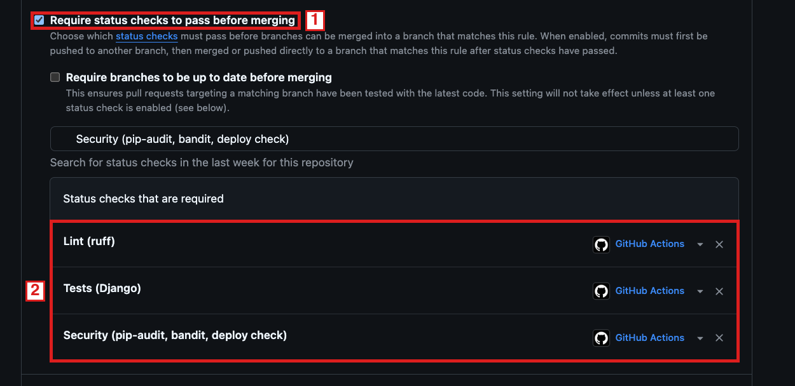

*Figure 29. The branch protection rule: `main` only accepts changes that passed all three checks.*

No approval from a second person is required, because there is only one developer. The rule still makes sure that every change is checked before it reaches `main`, and later, before it reaches the server.

Continuous Integration is now in place. Every push is checked for code style, broken pages, unsafe redirects, known security holes and unsafe production settings, in under a minute. The first run already found three real problems in the live site, and all three were fixed and confirmed by a green run.

## 4. The Docker Image: One Package That Runs the Same Everywhere

Continuous Integration proves that the code works. The next question is how exactly that code reaches the server. Today the server has its own Python, its own packages and its own Gunicorn, all installed by hand in the folder from section 2.2. If anything there differs from the Mac, the live site can behave differently from the tested one. A Docker image removes this risk: the code, Python, the packages and Gunicorn are packed into one unit, and the same unit is tested, stored and deployed.

### 4.1 The Dockerfile: How the Image Is Built

The image is described in a file called `Dockerfile`, a list of build steps that Docker runs from top to bottom (Figure 30):

1. The image starts from the official Python 3.11 image, the same Python version as in the pipeline. The `slim` variant leaves out tools the site does not need, so the image stays smaller.
2. The packages from `requirements.txt` are installed first. Docker reuses this step as long as `requirements.txt` does not change, so a change in the code alone builds in seconds.
3. The website's code is copied in. A second file, `.dockerignore`, keeps out what the image must never contain, such as the Git history, local settings and secret files.
4. The static files (styles, scripts, images) are collected into the image at build time, so the image is complete when it starts.
5. The site runs as a normal user, `appuser`, not as the all-powerful root user. If the site were ever broken into, the attacker would have far fewer rights.
6. Gunicorn starts the site, the same web server that runs the live site today (section 2.2).

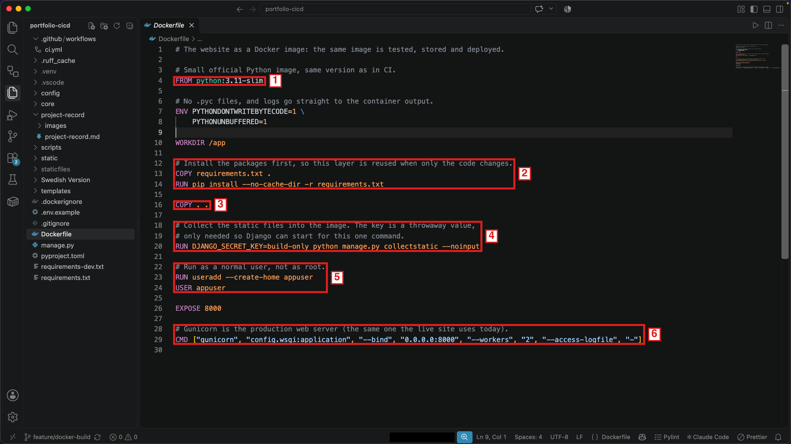

*Figure 30. `Dockerfile`: the build steps of the website image.*

### 4.2 The Image Runs on the Mac

Before the image was added to the pipeline, it was built and started on the Mac by hand. The build (Figure 31):

1. `docker build -t portfolio:local .` builds the image from the Dockerfile and names it `portfolio:local`.
2. Finished in 3.2 seconds, because the package step was reused from an earlier build.
3. The seven steps of the Dockerfile, in the same order as in Figure 30.
4. The finished image is saved under its name.

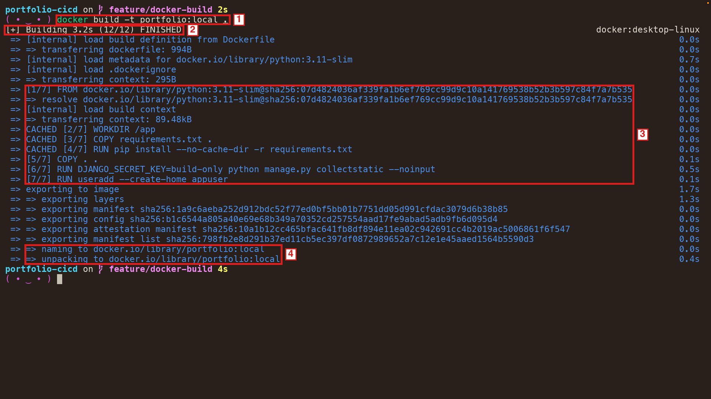

*Figure 31. The image is built on the Mac.*

A running image is called a container. It is started with one command (Figure 32):

1. `docker run -d --name portfolio -p 8020:8000 portfolio:local` starts a container from the image in the background. Gunicorn listens on port 8000 inside the container, and `-p 8020:8000` makes it reachable on port 8020 of the Mac. Docker answers with the ID of the new container.

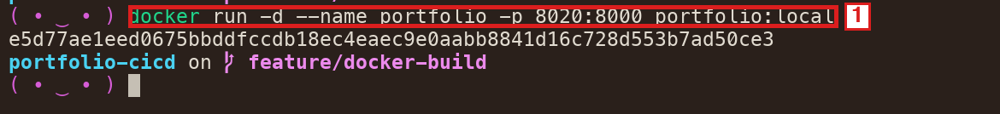

*Figure 32. A container is started from the image.*

The site from the container opens in the browser (Figure 33):

1. The address is `localhost:8020`, the port from Figure 32, so the page comes from the container and not from the development server.
2. The EN | SV switch is there, so both languages can be checked.

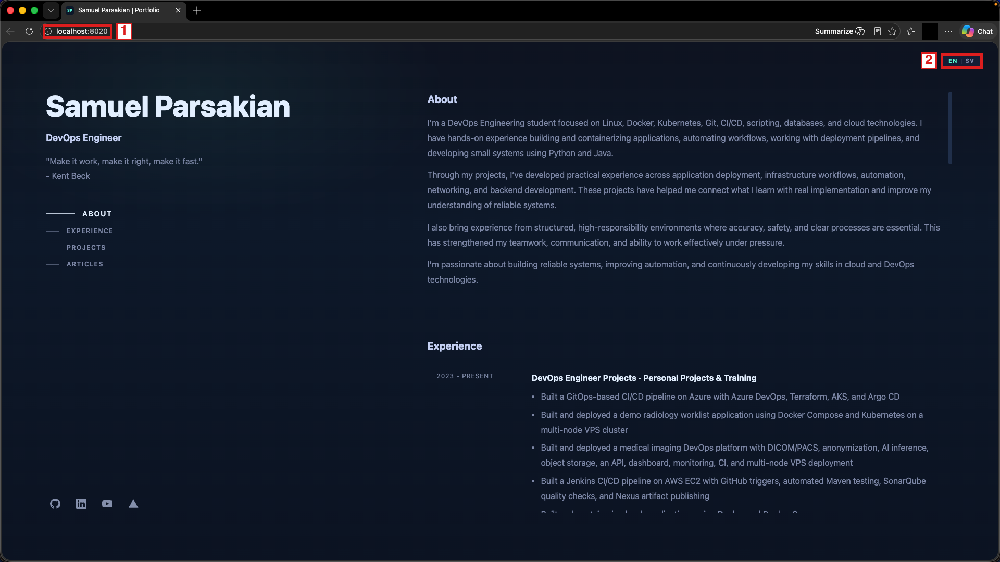

*Figure 33. The website, served by Gunicorn inside the container.*

Opening pages by hand does not scale, so a short script, `scripts/smoke_test.sh`, does the same checks automatically. A smoke test is a quick check that a running copy of the site really answers: it requests a few key pages over the network, just like a browser, and stops with an error if one of them is wrong. The unit tests from section 3.2 check the code; the smoke test checks the finished, running package. The same script is used later against the server. The result on the Mac (Figure 34):

1. The script is started with the address of the container.
2. Six checks: three main pages open, an unknown page answers "not found", the Swedish page contains "Om mig", and the stylesheet loads.
3. "Smoke test passed".

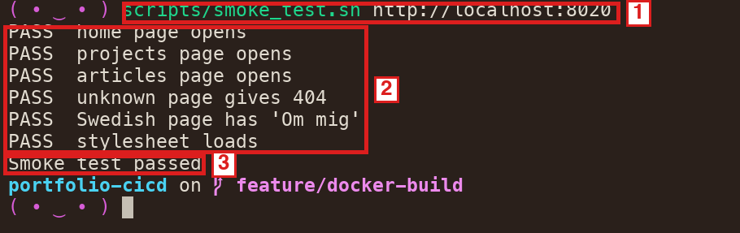

*Figure 34. The smoke test against the running container: all six checks passed.*

**Why the smoke test matters.** In the first version of the image, the Swedish texts were missing. The file that holds them had been listed in `.dockerignore` by mistake, and without it the site quietly shows English instead. All 10 unit tests still passed, because they run on the source code, where the file exists. Only the smoke test, which asks the running container for the Swedish page, failed: `FAIL Swedish page has 'Om mig'`. The line was removed from `.dockerignore`, the image was built again, and all six checks passed. Without the smoke test, this image could have gone live with a broken Swedish version.

### 4.3 The Image Is Built and Tested in the Pipeline

The same steps were added to the workflow as a fourth job, "Build and test the image (Docker)". It builds the image, names it after the Git commit, starts it with production settings (debug off, the real domain, a random secret key made only for this run) and runs the smoke test against it. If the smoke test fails, the job fails. A run of the workflow now looks like this (Figure 35):

1. The run was started by a pull request.
2. The three checks from section 3 run first, side by side.
3. The Docker job starts only when all three are green, shown by the line between them. There is no point in building an image from code that failed a check.

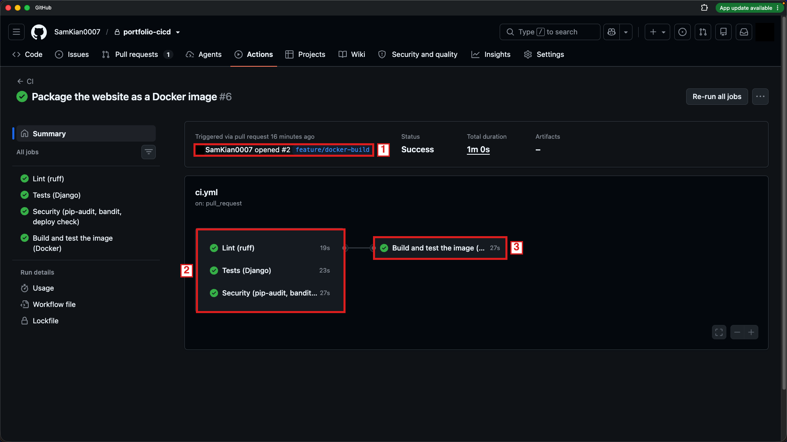

*Figure 35. The image is built and tested only after lint, tests and security have passed.*

The new job was also added to the branch protection rule from section 3.6, so `main` now requires all four checks before a change can be merged.

The website is now one Docker image that runs the same on the Mac and in the pipeline. Every change is packed into an image, started and checked with the smoke test, before anything goes near the server.

## 5. The Registry: Every Tested Image Is Stored and Traceable

The image from section 4 is built on a GitHub runner, and the runner is thrown away after each job. Without a place to keep the image, the server would have no way to get it. That place is a container registry.

### 5.1 What a Registry Is, and Why GitHub's Own Registry Was Chosen

A container registry is a storage service for Docker images, in the same way that GitHub is a storage service for code. Three words are used all the time:

- **push:** upload an image to the registry.
- **pull:** download an image from the registry, for example onto the server.
- **tag:** the name of one version of an image, written after a colon, for example `portfolio-cicd:78c7106...`.

There are several registries. The best known is **Docker Hub** (hub.docker.com), the public registry where the official Python image from Figure 30 comes from. The large cloud providers have their own, such as Amazon ECR and Azure Container Registry. Any of them would work for this project.

**GitHub Container Registry** (GHCR, at `ghcr.io`) was chosen, for three reasons:

- **Same place as the code.** The code, the pipeline and the images all live in one GitHub account, so there is no second service to manage.
- **No extra password.** The workflow logs in with the short-lived key that GitHub gives every run (`GITHUB_TOKEN`). Docker Hub would need its own account and an access key stored as a secret in GitHub.
- **Private by default.** The images of a private repository are private too, so only the owner and the pipeline can pull them.

### 5.2 How the Pipeline Stores the Image

Three steps were added to the end of the Docker job in `ci.yml`, right after the smoke test (Figure 36):

1. **Log in** to `ghcr.io` with the run's own key (`secrets.GITHUB_TOKEN`). `if: github.event_name == 'push'` means the step runs only for a push to `main`, never for a pull request.
2. **Push** the image that just passed the smoke test, tagged with the full Git commit ID (`github.sha`). The pipeline pushes the tested image itself; it never builds a second one, so the stored image is exactly the one that was checked.
3. **Add a version tag**, such as `v1.0.0`, when a release is marked with a Git tag of that name. This becomes important when the site goes live in section 6.

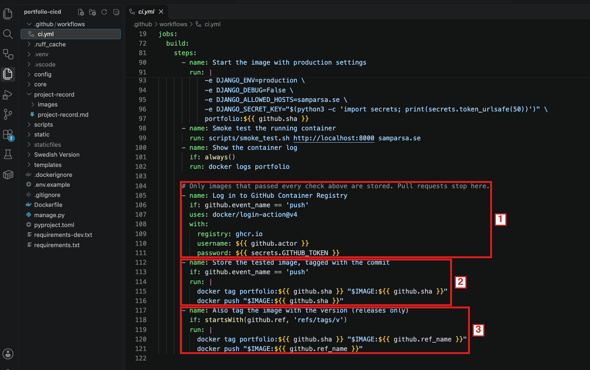

*Figure 36. `.github/workflows/ci.yml`, end of the Docker job: log in, store the tested image, add the version tag.*

These steps run only for changes on `main`. A pull request is still built and tested, but its image is not stored, so the registry only holds versions that were accepted into `main`.

Each image also carries two labels, small pieces of information stored inside it: the commit it was built from, and the repository it belongs to. Anyone who has the image can read them, even without access to GitHub.

### 5.3 Finding the Image on GitHub

The stored images are not in the list of files of the repository. They are in a separate part of GitHub called **Packages**. There are two ways to get there:

- From the repository: on the **Code** page, the right-hand column has a **Packages** section with a link to `portfolio-cicd`.
- From the GitHub profile: the **Packages** tab lists every package of the account.

The profile view (Figure 37):

1. The **Packages** tab of the profile.
2. The package `portfolio-cicd`: private, and published from the repository `SamKian0007/portfolio-cicd`.

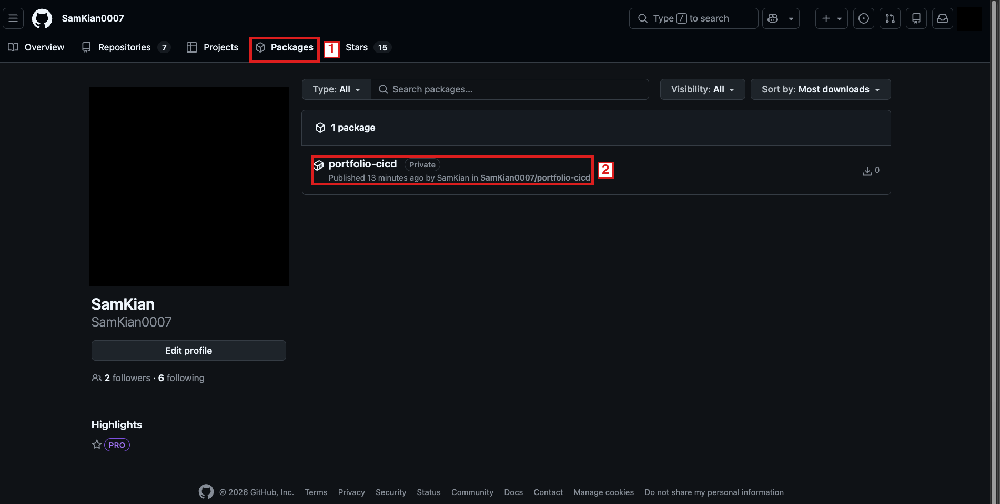

*Figure 37. The Packages tab: the website image is stored as the package portfolio-cicd.*

Clicking the package opens its page (Figure 38):

1. The package name, followed by the tag of the newest image: the full ID of commit `78c7106`, the change that added this registry step.
2. The package is private, and this is the latest image.
3. The command that downloads exactly this image. The server will use the same kind of command.
4. The list of stored versions. Every accepted change on `main` adds one entry, named after its commit.
5. The repository the package belongs to. GitHub makes this link from the label inside the image.

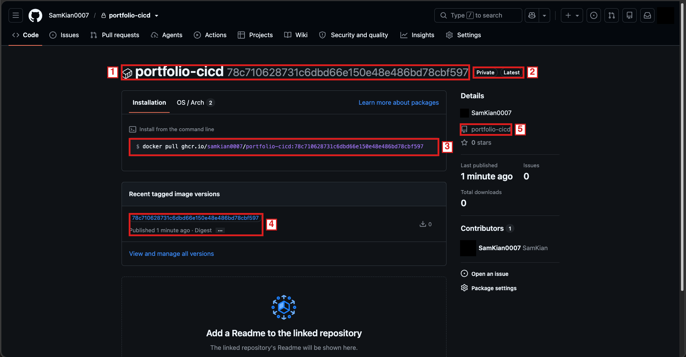

*Figure 38. The package page: every stored image is named after the commit it was built from.*

This is how a running version is traced back to its code: the tag of the image is the commit ID, and the commit ID leads straight to the change in the repository, its pull request and its pipeline run.

Every tested change on `main` is now stored as an image in GitHub's own registry, named after its commit and private to the owner. Any stored version can be pulled again at any time, which is exactly what the deployment to the server needs.

## 6. Deployment: The Same Image in Staging, Then in Production

The registry from section 5 holds every tested image. This section shows how an image gets from there onto the server: first into staging, where it is checked without visitors, and then, after a person approves, into production at samparsa.se.

### 6.1 The Server: Docker and a Dedicated Deploy User

The server needs three things before the pipeline can use it. They were set up once, by hand, over SSH as the administrator (root). Figure 39 shows the result:

1. **Docker**, installed from Docker's official package source for Ubuntu. Docker runs the containers.
2. **A user called `deploy`**, made only for the pipeline. It is a member of the `docker` group, so it can start and stop containers, but it is not the administrator. It has no password: it can only log in with one SSH key, and that key is stored in GitHub (section 6.2). If the key were ever stolen, it would open only this user, not the whole server.
3. **The settings file** `/etc/portfolio/production.env`. It holds the production settings of the site: the secret key, the domain and debug switched off. Only root can change it, and only the `deploy` user can read it (`-rw-r-----`, owner `root`, group `deploy`). The file stays on the server, so the secret key never appears in the code, in Git or in the pipeline logs.
4. **The two running containers** (`docker ps`), both started by the pipeline from the same image: `portfolio-production` on port 8003 and `portfolio-staging` on port 8002. Both ports are opened only inside the server (`127.0.0.1`), so visitors cannot reach them directly.

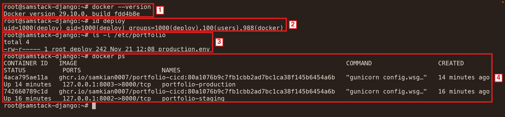

*Figure 39. The server: Docker, the `deploy` user, the settings file and the two containers.*

Nginx, the web server that receives every visitor on samparsa.se and holds the HTTPS certificate, passes each request on to the production container on port 8003. Staging has no public address. It is checked by the pipeline only.

### 6.2 GitHub: Environments, the Approval Rule and the Secrets

The pipeline needs two kinds of information from GitHub before it may touch the server: how to log in, and who may say "go live". Both are stored in **environments**, a GitHub feature that groups the settings and rules of one deployment target.

The approval rule (a required reviewer) is free on GitHub only for public repositories, so the repository was made public first. The code holds nothing secret: the secret key lives on the server (section 6.1), the SSH key lives in GitHub's secret store, and the image package from section 5 stays private. The repository page shows the change, and the **Settings** tab is where all the following settings are (Figure 40):

1. The repository is now **Public**.
2. The **Settings** tab.

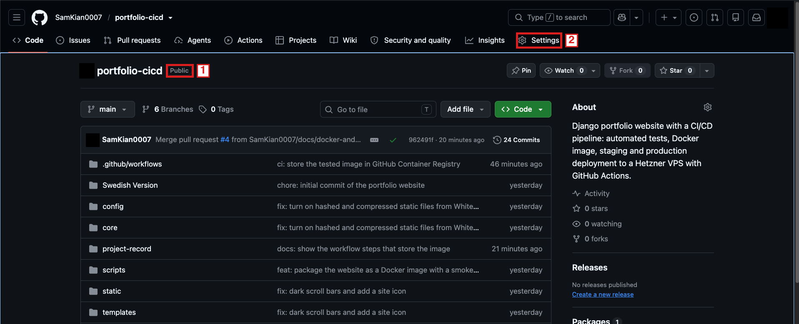

*Figure 40. The repository is public, and the Settings tab is at the top right.*

In **Settings** there is the **Danger Zone** at the bottom of the page. The visibility is changed there (Figure 41):

1. **Change repository visibility**, with the button **Change visibility**.

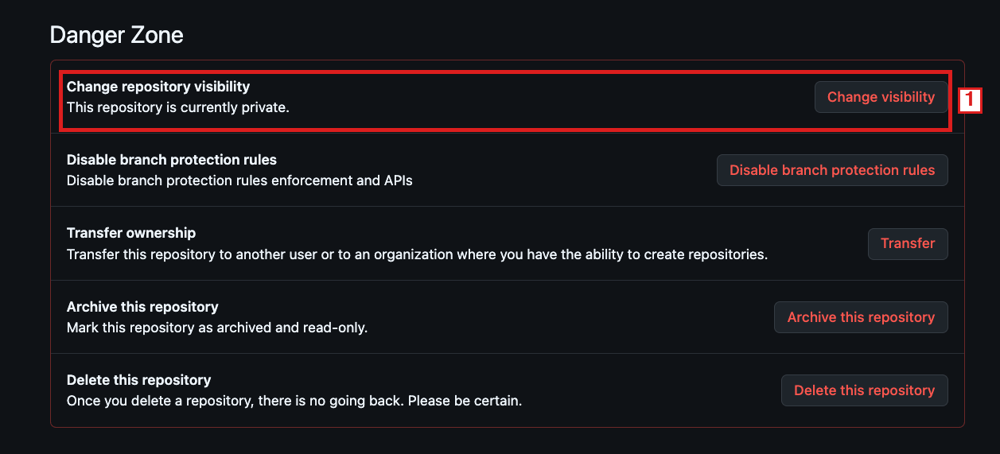

*Figure 41. The Danger Zone in Settings, where the repository was made public.*

Two environments were created, one for each container on the server (Figure 42):

1. The **Settings** tab.
2. **Environments** in the menu on the left.
3. **production**: two protection rules, two secrets and one variable.
4. **staging**: one protection rule, and the same secrets and variable.

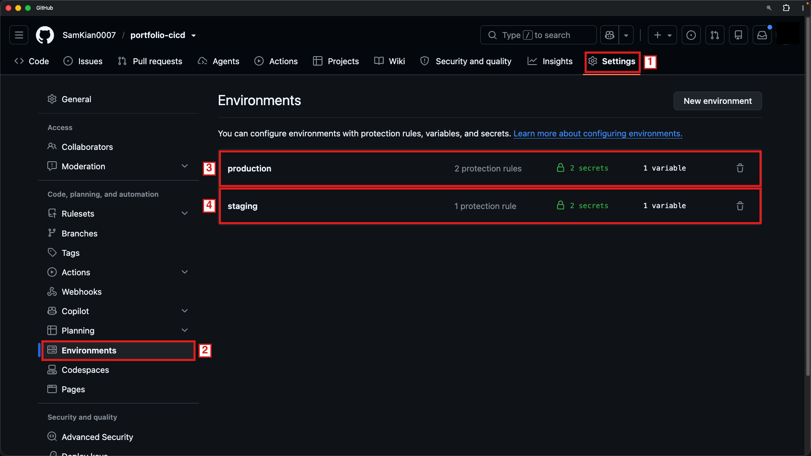

*Figure 42. The two environments, staging and production.*

**Where:** Settings > Environments > production.
**What is set:** the rule that a person must approve every deployment to production (Figure 43):

1. The page of the production environment.
2. **Required reviewers** is switched on, with Samuel's account as the reviewer. The pipeline stops before production and waits until he approves.

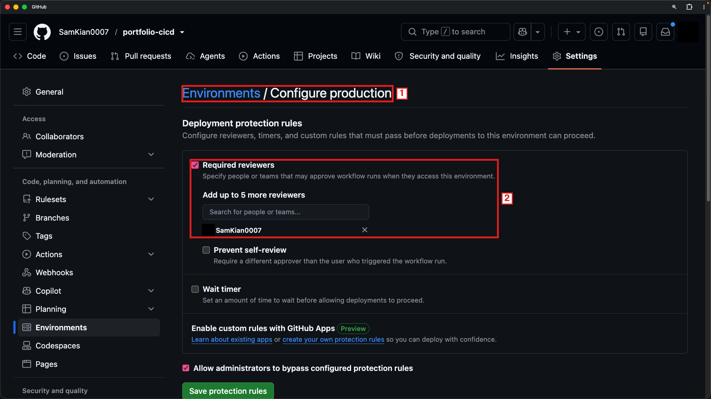

*Figure 43. Production needs an approval from Samuel before anything goes live.*

Further down on the same page are the other rule, the secrets and the variable (Figure 44):

1. **Deployment branches:** only protected branches, which means only `main`. A branch that was never checked and merged can never deploy, not even by mistake.
2. **Environment secrets:** `DEPLOY_SSH_KEY` is the private SSH key of the `deploy` user, and `DEPLOY_KNOWN_HOSTS` is the server's own fingerprint, so the pipeline can check that it talks to the real server. GitHub never shows a secret again after it is saved, and it hides secrets in the logs.
3. **Environment variable:** `DEPLOY_HOST`, the address of the server. It is not a secret, so it is a normal variable.

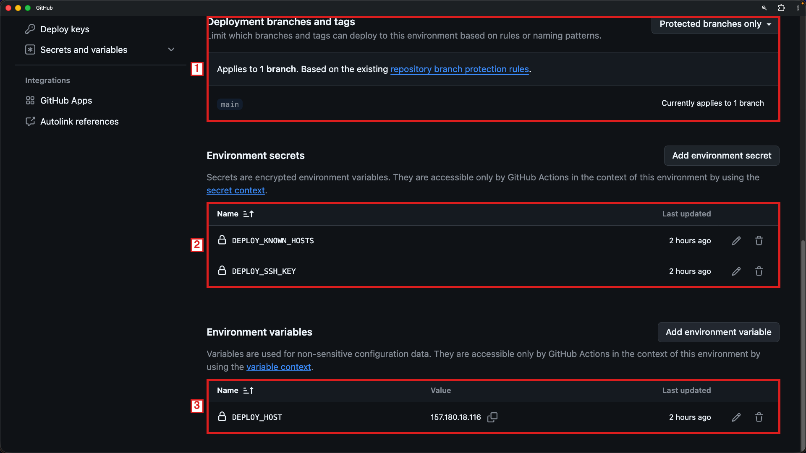

*Figure 44. Only `main` may deploy, and the SSH key is stored as a secret.*

The staging environment has the same secrets, the same variable and the same branch rule, but no reviewer: a release goes to staging on its own and is only checked by the pipeline.

### 6.3 The Deploy Script: Replace One Container With a New One

Staging and production are started in exactly the same way, so the steps live in one short script, `scripts/deploy.sh`. The pipeline sends it over SSH and runs it on the server, with three values: the image, the container name and the port (Figure 45):

1. The script in the `scripts` folder, next to the smoke test from section 4.2.
2. The three values. If one is missing, the script stops with a clear message instead of guessing.
3. `docker pull` downloads the image from the registry.
4. The old container with the same name is removed, and a new one is started from the new image. `--env-file` reads the settings file from section 6.1, `--restart unless-stopped` starts the container again after a server restart, and `-p 127.0.0.1:...` keeps the port inside the server.
5. Images that no container uses and that are older than one week are deleted, so the disk does not fill up. Every version stays in the registry and can be pulled again.

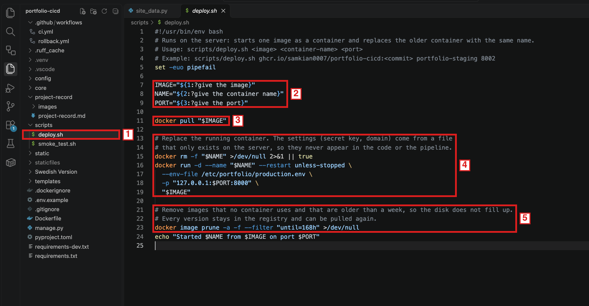

*Figure 45. `scripts/deploy.sh`: start the new image, replace the old container.*

### 6.4 The Workflow: Two New Jobs After the Build

Two jobs were added at the end of `ci.yml`. The staging job (Figure 46):

1. Still the same file, `ci.yml`.
2. `needs: build` means the job starts only after the Docker job from section 4.3 is green. `if:` means it runs only for a push to `main`, never for a pull request.
3. `environment: staging` connects the job to the staging environment and its secrets (section 6.2). `concurrency` makes sure that two deployments to staging never run at the same time.
4. The job may only read the code and the registry. `IMAGE` is the image named after this commit, the one that was just tested and stored.
5. The SSH key and the server fingerprint are written from the secrets into the runner. The step gets a short name, `ssh`, used again in the last step.
6. The server logs in to the registry with the run's own short-lived key (`GITHUB_TOKEN`, as in section 5.1). The key is sent through the SSH connection and is never written into a file.
7. The deploy script from Figure 45 starts the image as `portfolio-staging` on port 8002.

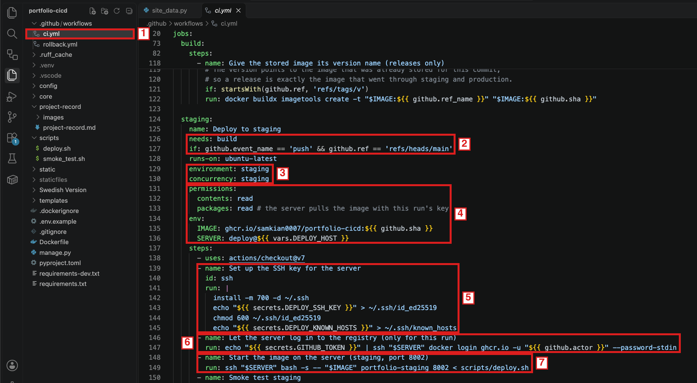

*Figure 46. `.github/workflows/ci.yml`: the staging job.*

The production job has the same steps, with three differences, and shows the last two steps that both jobs share (Figure 47):

1. `needs: staging`: production starts only after staging is green.
2. `environment: production` brings in the approval rule from Figure 43, so the job waits for Samuel before it starts. The `url` is shown on the run page as a link to the live site.
3. The **same** image, named after the same commit, is started as `portfolio-production` on port 8003. Nothing is built again between staging and production.
4. The smoke test from section 4.2 runs on the server against the new container. If one of the six checks fails, the job fails and the run turns red.
5. The server logs out of the registry again, so no login stays behind on the server. `always()` makes this step run even when an earlier step failed, but only when the SSH step worked, because without SSH the server cannot be reached.

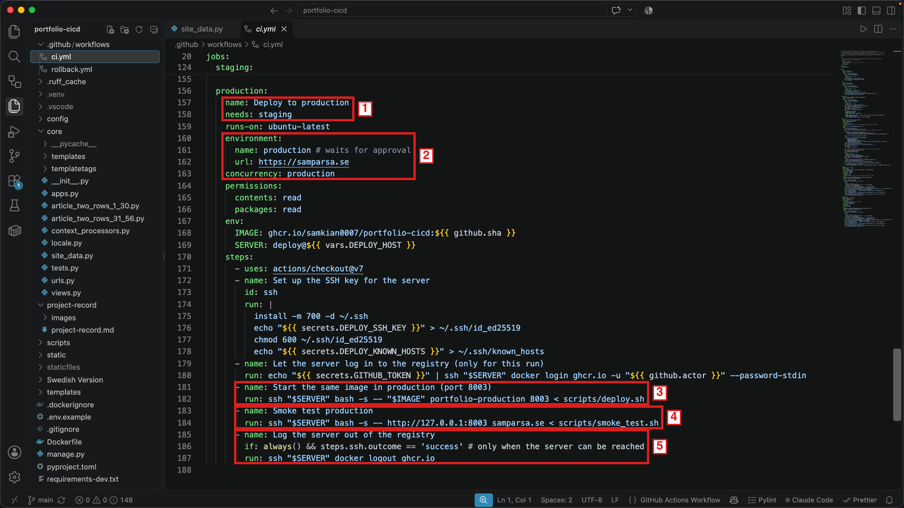

*Figure 47. `.github/workflows/ci.yml`: the production job, with the smoke test and the logout.*

### 6.5 The First Release: From a Merge to the Live Site

The first full run went from the merge of the deployment change into `main` all the way to the live site. After lint, tests, security and the Docker job, the run stopped and waited (Figure 48):

1. **Deploy to staging** is green: the image runs on the server on port 8002 and passed the smoke test.
2. **Deploy to production** waits for review.
3. GitHub shows that a review is needed, with the button **Review deployments**.

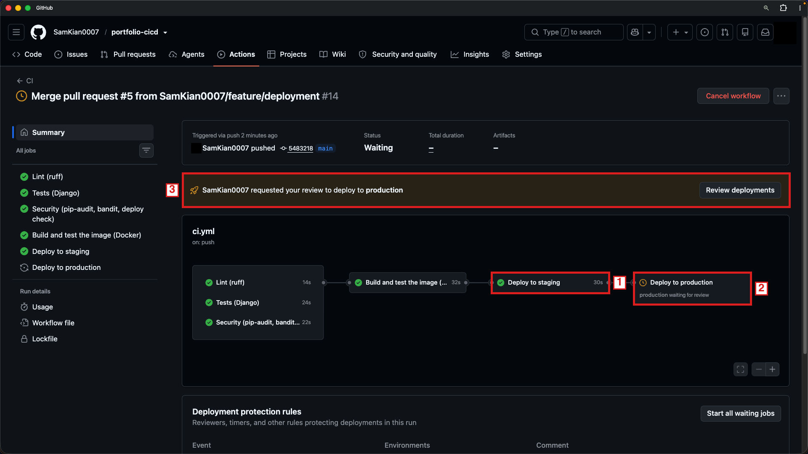

*Figure 48. Staging is done, and production waits for a person.*

**Review deployments** opens a small window (Figure 49):

1. The production environment, which needs a review from Samuel.
2. **Approve and deploy** lets the production job start. **Reject** would stop the release, and nothing would change on the live site.

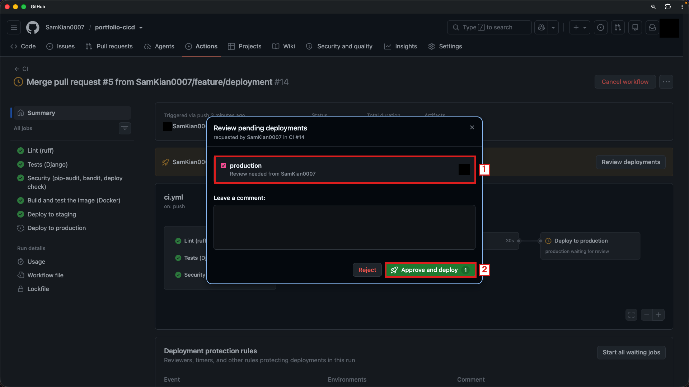

*Figure 49. The release is approved.*

The finished run (Figure 50):

1. **Success**, in 4 minutes 21 seconds. Almost 3 minutes of that was the time until the approval. The production job itself took 19 seconds.
2. All six jobs are green, from lint on the left to production on the right.

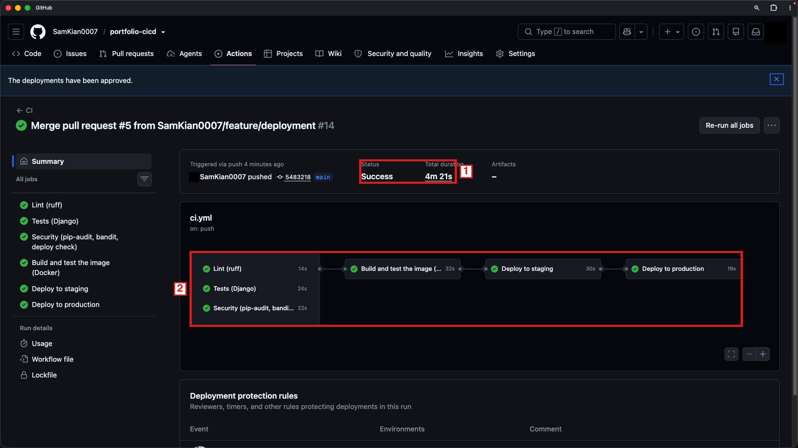

*Figure 50. The first release: every job is green, from the checks to production.*

The live site at samparsa.se now comes from the container. Both languages were checked in the browser (Figure 51):

1. The address is `https://samparsa.se`, the real site.
2. The language switch works: English on the left, Swedish on the right.

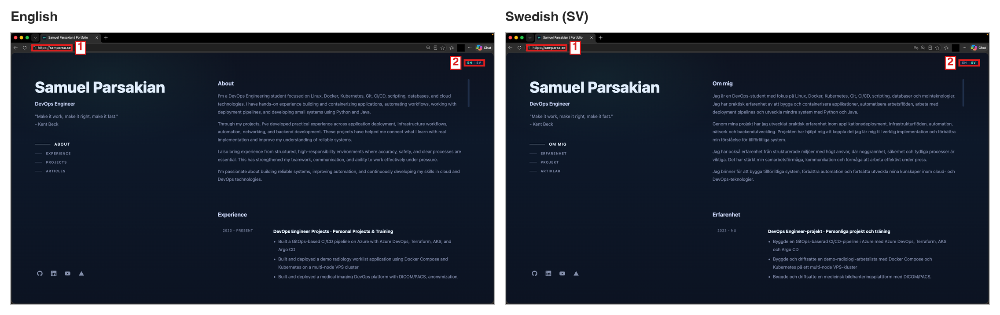

*Figure 51. samparsa.se, served from the production container, in English and Swedish.*

### 6.6 The First Version: v1.0.0

The first working state on the server was marked as a release: the Git tag `v1.0.0` was added to the commit that was running in production. The tag starts the workflow once more, and the step from Figure 36 gives the image that is already stored the extra name `v1.0.0`. Nothing is built again, so `v1.0.0` is exactly the image that passed staging and went live. This name is used again in section 8.

Every accepted change on `main` now goes the same way: checks, image, staging with a smoke test, approval, production with a smoke test. Samuel only merges and approves. The live site at samparsa.se runs from a Docker image that can be traced to its commit, and the first release is kept as `v1.0.0`.

## 7. November 21: A Broken Change Is Stopped Before It Reaches the Site

The pipeline from sections 3 to 6 was built to stop mistakes before they go live. The first real test came on the same day, from a change that looked very small.

### 7.1 What Happened: A Small Text Change Fails Three Checks

Samuel wanted to change the quote on the home page. The text lives in `core/site_data.py`. The change was made in VS Code on a new branch, `feature/new-quote`, and a pull request (#7) was opened. A few seconds later, the pull request showed this (Figure 52):

1. The whole pull request page, with the checks in the middle.
2. Three checks failed: lint, security and tests. All three are required (section 3.6).
3. The Docker job and both deployments were skipped, because they only start when the checks are green.
4. **Merge pull request** is greyed out. The change cannot reach `main`.

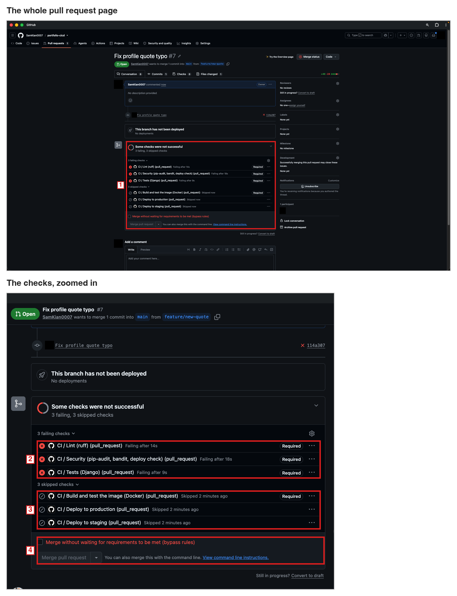

*Figure 52. Pull request #7: three checks failed, the rest was skipped, and the merge is blocked.*

For the visitors, this means:

- **Nothing changed.** The live site never saw the broken code. Without the checks, this change would have been copied to the server.

For Samuel, this means:

- **The merge is blocked** until the problem is found and fixed.
- **The cause is not obvious.** Only one line of text was meant to change.

### 7.2 Finding the Cause: From the Red Check to the Line in the File

Each red check has a log. The way to the cause is always the same: open the log, find the file and line it names, and look at that line.

**Step 1: the lint log.** A click on **Details** next to the failed lint check opens its log (Figure 53):

1. The failed job, **Lint (ruff)**.
2. `F821 Undefined name 'Í'` and the place: `core/site_data.py:4:1`, which means file `core/site_data.py`, line 4, column 1.
3. Line 4 holds only one character, `Í`. Ruff points at it with `^`.
4. `Found 3 errors`. The other two are about the same line, or about the order of the import lines at the top of the file.

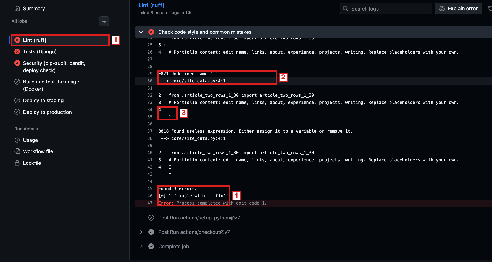

*Figure 53. The lint log names the file and the line: `core/site_data.py`, line 4.*

**Step 2: the test log.** The tests fail for the same reason. A test log can be long; the useful part is at the end (Figure 54):

1. The failed job, **Tests (Django)**.
2. The last file in the list is `core/site_data.py`, line 4. Each line above it is one step on the way there, so the last one is where the problem is.
3. `NameError: name 'Í' is not defined`. Python reads `Í` as the name of something that does not exist. The file cannot be loaded, and without it no page of the site can be shown.

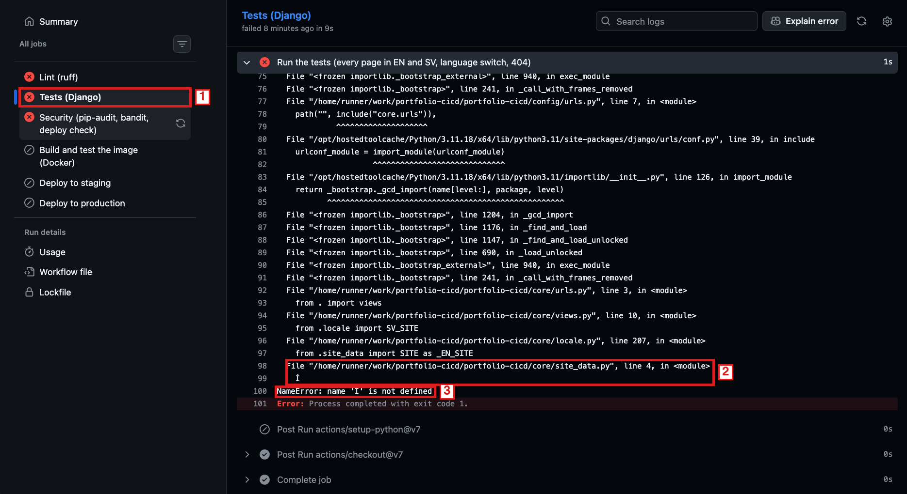

*Figure 54. The test log ends at the same file and line.*

The security job failed in the same way, because its last check (`check --deploy`) also loads the site's code.

**Step 3: the changes in the pull request.** The tab **Files changed** shows every line the pull request adds or removes, compared to `main` (Figure 55):

1. The tab **Files changed**.
2. `+46 -24`: 46 lines added and 24 removed, far more than one changed line.
3. Line 4: the extra character `Í`, added by a slip of the keyboard.
4. and 5. The two import lines at the top were moved: VS Code sorted them again when the file was saved (the "format on save" setting). This is the third lint error.
6. The intended change: the quote. Many of the other changed lines are long lines that the editor broke into two.

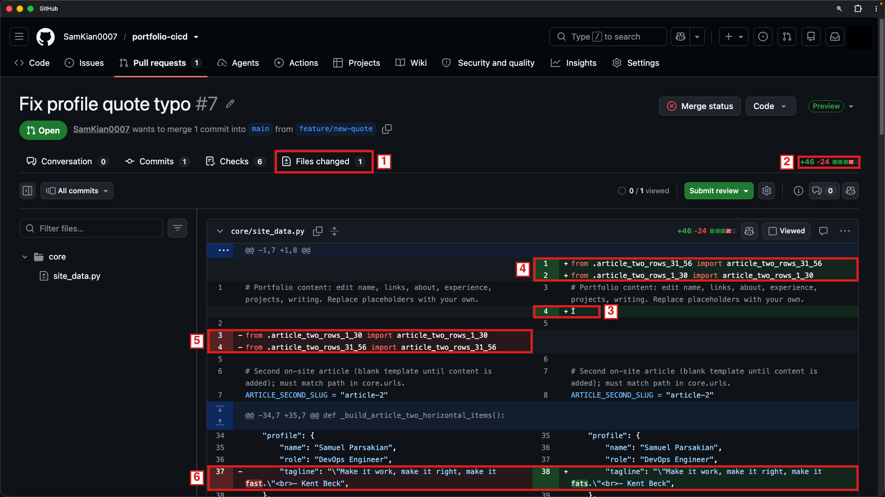

*Figure 55. Files changed: the stray character, the moved imports and the quote.*

**Step 4: the file in VS Code.** The same file, opened on the Mac (Figure 56):

1. `site_data.py`, marked as changed (`M`) and with one problem (`1`).
2. Line 4, with the stray `Í`, underlined by the editor.
3. The two import lines, in the order the editor gave them.

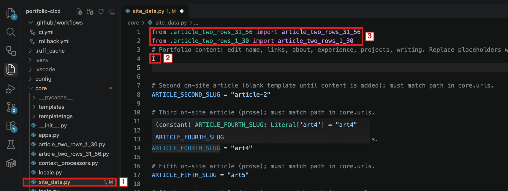

*Figure 56. `core/site_data.py` on the Mac: the stray character on line 4.*

The cause, in short: one stray character made the file unreadable for Python, and the editor's automatic formatting changed lines that were never meant to change.

### 7.3 Defining the Fix

The quick fix would be to delete the one character. That fixes two of the three lint errors, but the moved imports and the re-wrapped lines would stay, and the pull request would still change far more than the quote.

| Goal | Today | Expected after the fix |
|---|---|---|
| **Code loads** | `NameError` on line 4 | All 10 tests pass |
| **Only the intended change** | `+46 -24` in one file | The quote, and nothing that changes how the site works |
| **Merge allowed** | 3 required checks red | All required checks green |

In short, the file must be the same as on `main` again, with only the new quote added.

### 7.4 The Fix: Start Again From the Version on main

**Problem 1: a stray character.** Line 4 holds `Í`, which Python cannot read. *Solution: take the file from `main`.* The command `git checkout main -- core/site_data.py` replaces the file on the branch with the last checked version, the one that is live.

**Problem 2: changes nobody asked for.** The editor sorted imports and broke lines on save. *Solution: check before pushing.* After the file was taken from `main`, lint and the tests were run on the Mac, before anything was pushed (Figure 57):

1. The file is taken back from `main`.
2. `ruff check`: All checks passed.
3. The Django tests: all 10 tests OK.

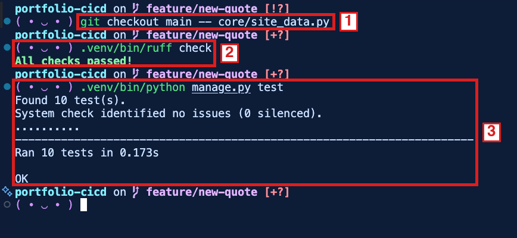

*Figure 57. The same checks as in the pipeline, run on the Mac before the push.*

Then the new quote was added again, and the change was committed and pushed. "Format on save" was also switched off in VS Code, so the editor no longer changes lines that were not touched.

### 7.5 Testing the Fix: Pull Request #7 Revisited

| Check | Before the fix | Expected after the fix |
|---|---|---|
| Lint, tests, security | Red | Green |
| Docker job | Skipped | Green |
| Merge | Blocked | Allowed |

The pipeline ran again on the new commits (Figure 58):

1. The three commits of the branch: the first one failed (red cross), the file was taken back from `main`, and the quote was added again (green tick).
2. **All checks have passed.** The deployments are skipped, as for every pull request: they only run after the merge.
3. **Merge pull request** is green and can be used.

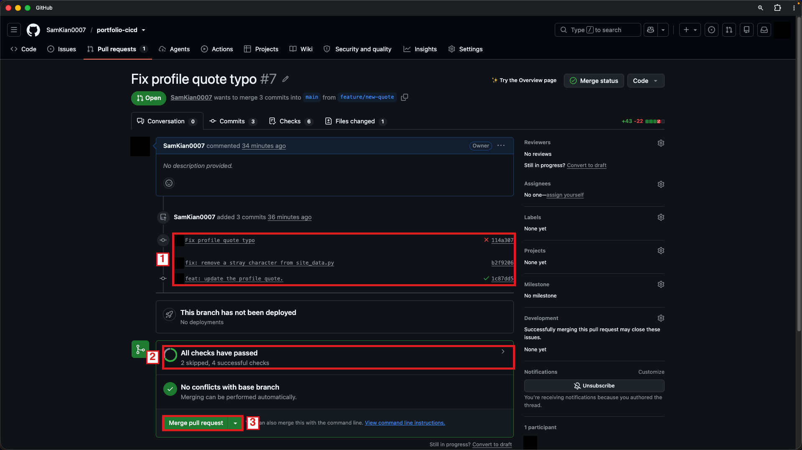

*Figure 58. Pull request #7 after the fix: all checks passed, and the merge is allowed.*

The expected results were reached: the checks are green, and the merge is allowed again.

One stray character would have taken the whole site down, and the checks stopped it in under half a minute, before it could reach `main`. The logs led straight to the file and the line, and the fix was confirmed on the Mac and again in the pipeline.

## 8. November 21: A Typo Reaches the Live Site, and a Rollback Brings Back the Previous Version

Section 7 showed a mistake that the checks can find. This section shows one they cannot, and what happens then.

### 8.1 What Happened: "Make It Fats"

The quote that was added again in section 7.4 had a typo: "make it **fats**" instead of "make it **fast**" (Figure 59):

1. The commit `feat: update the profile quote.`
2. Line 37: `make it fats`.

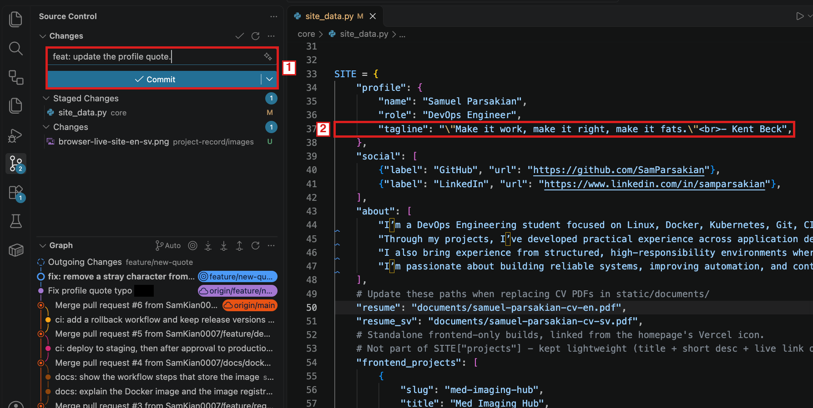

*Figure 59. The quote with the typo, committed on the branch.*

Every check passed: the code is correct Python, every page opens, and the smoke test finds "Om mig" on the Swedish page. No check reads the meaning of the text. The pull request was merged, staging passed, the release was approved, and at 15:06 the live site showed "make it fats" (the left side of [Figure 65](images/browser-live-site-typo-and-after-rollback.png)).

For the visitors, this means:

- **A visible mistake** in the first line under the name, on the portfolio of someone who applies for DevOps jobs.

For Samuel, this means:

- **The site must be right again quickly**, without waiting for a new fix to go through the whole pipeline.

### 8.2 Defining the Fix: Go Back First, Fix Afterwards

The quick fix would be to change the text directly on the server. It would be fast, but the live site would then differ from `main` and from every stored image, nothing would be checked, and the next release would bring the typo back.

A new fix through the pipeline is the right way to correct the text, but it takes time: the change, the pull request, the checks, the build, staging and the approval.

| Goal | Today (typo live) | Expected after the rollback |
|---|---|---|
| **Fast** | A new release takes minutes, plus the time to write the fix | The site is right again in about one minute |
| **No new build** | - | A stored, already tested image is started again |
| **Same control** | - | The same approval as a normal release |
| **Checked** | - | The same smoke test as a normal release |

In short, the previous version goes back first, and the text is fixed afterwards through the normal pipeline.

### 8.3 The Rollback Workflow

A rollback is its own workflow, `rollback.yml`. It is started by hand from the Actions tab and takes one value: the version to go back to (Figure 60):

1. The file `rollback.yml`, next to `ci.yml`.
2. `workflow_dispatch` means "start by hand". The form asks for one value: a full commit ID or a release name such as `v1.0.0`. Both are names of images in the registry (sections 5.2 and 6.6).
3. The job uses the **production** environment, so it needs the same approval as a normal release and the same secrets.
4. The version name is checked first. Anything that is not a 40-character commit ID or a release name like `v1.0.0` stops the run before the server is touched.
5. Spaces around the typed version are removed before the check. These two lines were added after the first rollback attempt (section 8.4).
6. The same deploy script and the same smoke test as in `ci.yml`. The image is pulled from the registry and started; nothing is built.
7. The logout step from Figure 47.

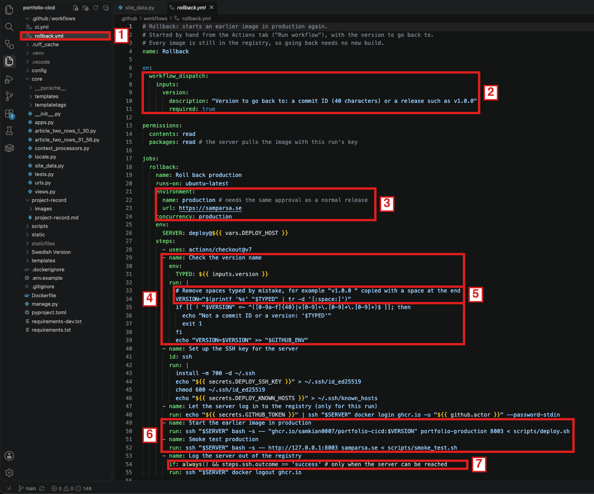

*Figure 60. `.github/workflows/rollback.yml`: start a stored image in production again.*

### 8.4 The Rollback: Two Tries

The rollback was started from **Actions > Rollback > Run workflow**, with `v1.0.0`, the last version without the typo (section 6.6). It needed two tries (Figure 61):

1. **Run workflow** opens the form.
2. The first try: `v1.0.0 `, typed with a space at the end. The space cannot be seen in the form.
3. The first run failed.
4. The second try: `v1.0.0`, without the space.

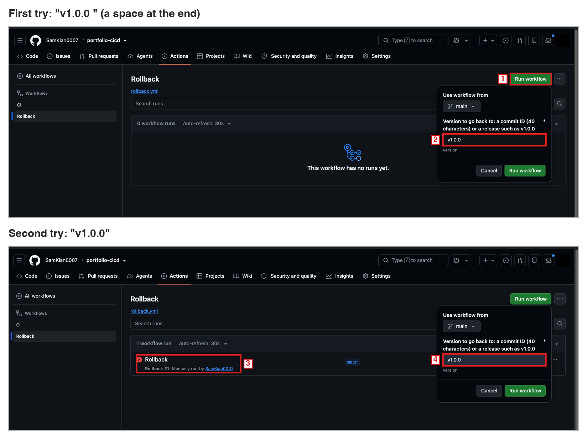

*Figure 61. The rollback form: the first try with a hidden space, and the second try.*

The log of the first run shows why it failed (Figure 62):

1. **Rollback #1** failed.
2. The version check stopped the run: `Not a commit ID or a version: v1.0.0`. The space after `v1.0.0` is part of the value, so it is neither a commit ID nor a release name.
3. All the steps that touch the server were skipped. Production was not changed.
4. The logout step failed too, with `Host key verification failed`. It runs even after a failure, but the SSH key had never been set up, so it could not reach the server. This second error is only a result of the first one.

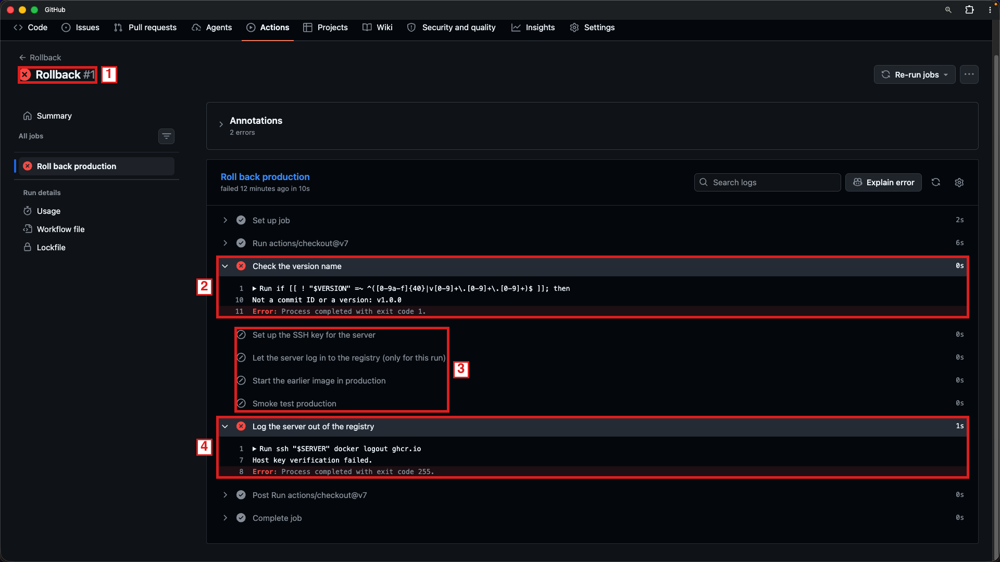

*Figure 62. Rollback #1: the version check stopped the run, and production was not touched.*

The second run, after the approval (Figure 63):

1. **Rollback #2**.
2. **Success**, in 55 seconds from the start, including the approval.
3. The job itself, from the image pull to the smoke test, took 19 seconds.
4. The approval for production, the same as for a normal release.

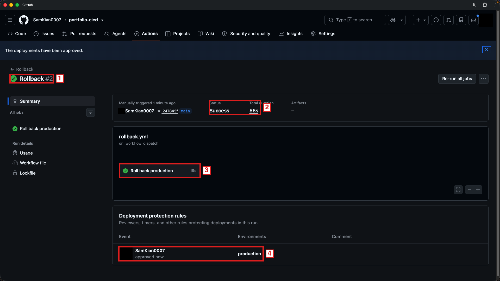

*Figure 63. Rollback #2: production runs `v1.0.0` again after 55 seconds.*

The list of runs shows the whole incident, with the newest run at the top (Figure 64):

1. Rollback #2: green, 55 seconds.
2. Rollback #1: red.
3. The merge of pull request #7, the release with the typo.
4. When each rollback started and how long it took.

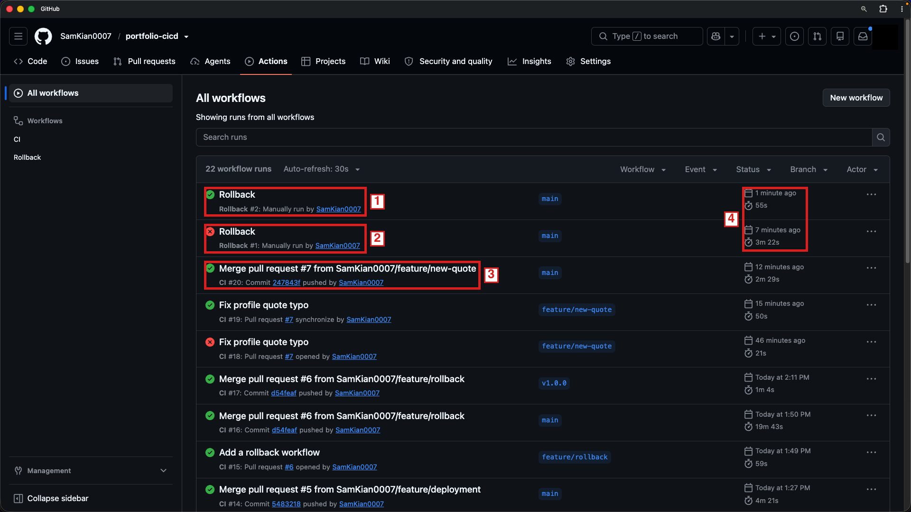

*Figure 64. The release with the typo, the failed rollback and the successful rollback.*

### 8.5 Testing the Rollback: The Live Site Revisited

| | After the release | Expected after the rollback |
|---|---|---|
| Quote on samparsa.se | "make it fats" | "make it fast" |
| Image in production | The commit with the typo | `v1.0.0` |
| Smoke test | Passed | Passed |

The live site before and after (Figure 65):

1. The release with the typo, at 15:06: "make it fats".
2. After the rollback, at 15:16: "make it fast".

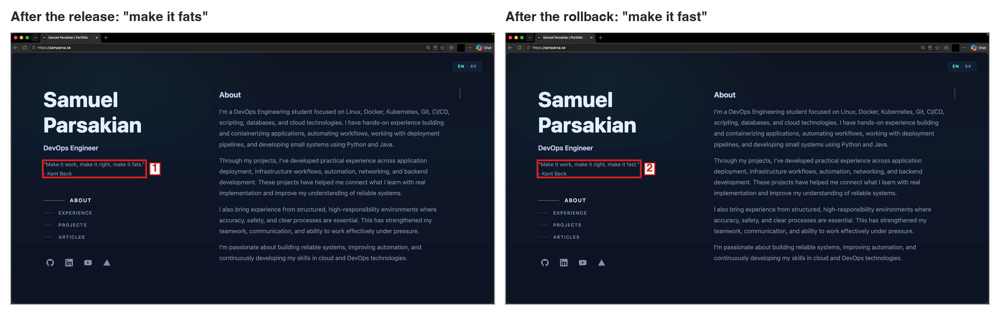

*Figure 65. samparsa.se after the release with the typo, and after the rollback.*

The expected results were reached: the typo was live for about 10 minutes, and the rollback itself took 19 seconds on the server, without a new build.

### 8.6 The Real Fix and the Lesson Learned

The rollback fixed the live site, but `main` still held "fats", so the next release would have brought it back. The text was then fixed the normal way: a new branch, `fix/quote-typo`, one changed word, pull request #8, all checks green, merge, staging, approval and production. `main`, staging and production now all hold "make it fast".

The first rollback attempt showed a weak point: in an emergency, one hidden space cost a failed run and a second approval, and the logout error made the log harder to read. Two small changes followed, through pull request #9:

- Spaces around the typed version are removed before the check (box 5 in [Figure 60](images/vscode-rollback-yml.png)). A wrong name such as `v1.0` is still rejected.
- The logout step runs only when the SSH step worked (box 7 in [Figure 60](images/vscode-rollback-yml.png), and the same in `ci.yml`), so a stopped run shows one clear error instead of two.

Some mistakes cannot be found by any check, and this one reached the live site. Because every release is stored as an image, the previous version was back in production after one approval and 19 seconds of work on the server, and the real fix then went through the normal pipeline. The rollback is now also safer to use, because a stray space no longer stops it.
