# Portfolio Website CI/CD

This project is the final assignment in the course Continuous Integration and Continuous Delivery (DevOps program, Nackademin). The task is to take a real application and build a full CI/CD pipeline around it. The application chosen here is a real personal portfolio website: a Django application that presents projects, articles and professional experience in English and Swedish.

Before this project, every change to the website was copied to the server by hand. The goal is to make delivery automatic and safe: each change is tested, packaged as a Docker image, checked in a test environment and then deployed to the live server on Hetzner, with a clear way back to an earlier version if something goes wrong. Each step of the pipeline is explained, together with why it exists.

The project is a course assignment, but it is built on a real system: the website is the real portfolio, and the pipeline is meant to stay in use after the course. The solution is therefore sized to the website. It is a small site with no database on one server, so the pipeline aims to be clean, reliable and easy to follow, not a large enterprise setup. Where a real production setup would go further, this is pointed out.

## 1. Before and After: From Manual Updates to a Pipeline

The portfolio website at samparsa.se already runs on a rented server. This section shows in two pictures how an update reaches the live site today, and how it should reach it when the pipeline is in place.

### 1.1 Before: Every Update Goes Straight to the Server

Samuel, the developer and owner of the site, does every step of an update by hand. Figure 1 shows the whole update from above. The numbers in the figure match the steps below.

*Figure 1. Before: an update goes from the Mac straight to the live server.*

1. **Changes the code.** The Django site is edited on the Mac.
2. **Copies the files.** The new files are sent to a folder on the server over SSH (a secure connection to the server).
3. **Restarts the site.** Gunicorn, the program that runs the Django code on the server, is restarted so that the new code is used.
4. **Checks the site.** samparsa.se is opened in the browser to see if the pages still look right.

**No checks before release.** There are no automated tests. An error is found only after the update is live, by checking the pages manually in the browser.

**Old versions pile up.** The server holds 9 app folders in `/var/www/`, from `samstack` to `samstack_next7`, and only one of them, `samstack_next4`, is live. The folder names do not say which version of the site each one holds.

**Why is this a problem?**

- **Availability:** a faulty update can make pages or the whole site unavailable until it is fixed by hand.
- **Maintenance:** every update is a series of manual steps on the live server, with no record of what changed or when, and no quick way back to a known working version.

### 1.2 After: Every Change Goes Through the Pipeline

With the pipeline, the developer only pushes the change to GitHub and approves the release. The checks, the build and the deployment run automatically. Figure 2 shows the same update in the new way.

*Figure 2. After: every change goes through tests, a Docker image and a staging test before it goes live.*

1. **Pushes a change.** The code is committed and pushed to GitHub. Every change then has its own commit, so it can be traced later.
2. **Tests and checks.** GitHub Actions (GitHub's built-in automation) runs the Django tests, a code style check (lint) and security scans. They catch errors and known security problems before anything is built.
3. **Builds the image.** Only if every check passes, the site is packed into one Docker image (a ready-to-run package of the site with everything it needs), named after the Git commit. The image runs the same way everywhere, so the version that was tested is exactly the version that goes live.
4. **Stores the image.** The image is saved in the GitHub container registry (GHCR), so every version is kept and the previous one can be started again.
5. **Tests in staging.** The image runs on the server in a separate test copy of the site, called staging, and is checked automatically. A problem shows up there first, not on the live site.
6. **Approves the release.** The developer looks at staging and approves the release in GitHub. A person stays in control of what goes live.
7. **Goes live.** The same image is started in production (the live site) and checked again. The previous image is kept.

Figure 3 shows the same pipeline in the usual CI/CD form, as one line of stages. The blue part is Continuous Integration (CI): it checks and packs every change. The green part is Continuous Delivery (CD): it takes the packed change to the server. The table below follows the same numbers.

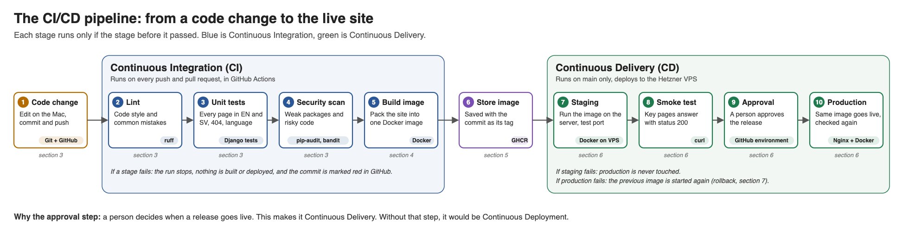

*Figure 3. The pipeline stages: CI in blue, the stored image in purple, CD in green.*

| Stage | What it does | Why it is there |
|---|---|---|
| 1. Code change | The change is committed and pushed to GitHub | The push starts the pipeline, and the commit makes the change traceable |
| 2. Lint | `ruff` checks code style and common mistakes | Simple errors are caught in seconds, before the slower stages run |
| 3. Unit tests | Django tests open every page in English and Swedish | A broken page or language switch is found before it can reach the server |
| 4. Security scan | `pip-audit` checks the packages, `bandit` checks the code | Known security holes are found before they are deployed |
| 5. Build image | The site is packed into one Docker image | The tested code and everything it needs travel as one unit |
| 6. Store image | The image is saved in GHCR, tagged with the commit | Every version is kept and can be traced back to its commit |
| 7. Staging | The image runs on the server on a test port | The release is tried on the real server, without visitors |
| 8. Smoke test | The key pages are requested and must answer with status 200 | Proof that the release really works on the server |
| 9. Approval | A person approves the release in GitHub | The decision to go live stays with a person |
| 10. Production | The same image goes live and is checked again | The live site gets exactly the version that passed staging |

**The main difference:** a faulty change is stopped by the tests or in staging, before it reaches production. Rolling back means starting the previous image again.

### 1.3 Before vs. After

| | Before (by hand) | After (CI/CD pipeline) |
|---|---|---|
| **How an update reaches the server** | Files copied by hand over SSH | Pipeline deploys a Docker image |
| **Tests before going live** | **None** | Django tests, lint and security scans on every change |
| **Test environment** | **None**, changes go straight to the live site | Staging on the same server, checked automatically |
| **Versions** | **9 app folders** in `/var/www/`, not labelled | Each image named after its Git commit |
| **Going back to an older version** | Find the right folder and switch by hand | Start the previous image again |
| **Check after an update** | Manual check in the browser | Automated checks on the live pages |

In short, the manual update works, but nothing protects the live site from a faulty change. The pipeline adds the checks, the versions and the way back that are missing today.

## 2. The Starting Point: The Website and the Server

Before anything is automated, the starting point must be clear: what the website is, how it runs on a computer, and how it runs on the live server today. A known working starting point matters, because any later problem can then be compared with it.

### 2.1 The Website Runs on the Mac

The website is a Django application (Django is a Python framework for building websites). It has a few features that keep it simple:

- **No database.** All texts, projects and articles are stored in the code itself, so there is nothing to back up or migrate.
- **Two languages.** English and Swedish. The EN | SV switch in the corner saves the choice in a cookie.
- **Static files** (images, styles, scripts, CV files) are served by WhiteNoise, a small Python package that lets Django serve them itself.

The project is organized in the usual Django way (Figure 4):

1. `config/` holds the project settings (`settings.py`), the main address list (`urls.py`) and `wsgi.py`, the entry point a production server such as Gunicorn uses to start the site.
2. `core/` is the application itself: the pages (`views.py`), their addresses (`urls.py`), the HTML templates, and all texts, projects and articles (`site_data.py` and the two `article_two_rows` files). `locale.py` loads the Swedish texts.
3. `project-record/` is this document and its images. It is part of the project, so the documentation is versioned together with the code.
4. `static/` holds the CSS, JavaScript, images and the CV files in English and Swedish.
5. `Swedish Version/SV-TRANSLATION.txt` holds all Swedish texts in one file.
6. `templates/base.html` is the shared page frame that every page is built on.
7. `manage.py` is Django's command tool, and `requirements.txt` lists the exact Python packages and versions the site needs: Django 5.2.10, django-environ 0.12.0 and WhiteNoise 6.11.0.

*Figure 4. The project folders, opened in VS Code.*

Two more files matter for safety. `.gitignore` keeps local and secret files out of Git, and `.env.example` shows which settings (for example the secret key) must be given from outside, so that no secret is stored in the code.

To prove that the website works from its project folder, it was started with Django's built-in development server (Figure 5):

1. The command `python3.11 manage.py runserver 8010` starts the website on the Mac, on port 8010.
2. Django checks the project first and finds no problems.
3. The website is now reachable at `http://127.0.0.1:8010/`, an address that only works on this Mac.
4. Django warns that this server is only for development. A real website needs a production server such as Gunicorn. This becomes important later, when the Docker image is built.

*Figure 5. The website starts on the Mac with no problems found.*

The home page then opens in the browser (Figure 6):

1. The address is the local one from Figure 5.
2. The language switch shows EN as the active language.

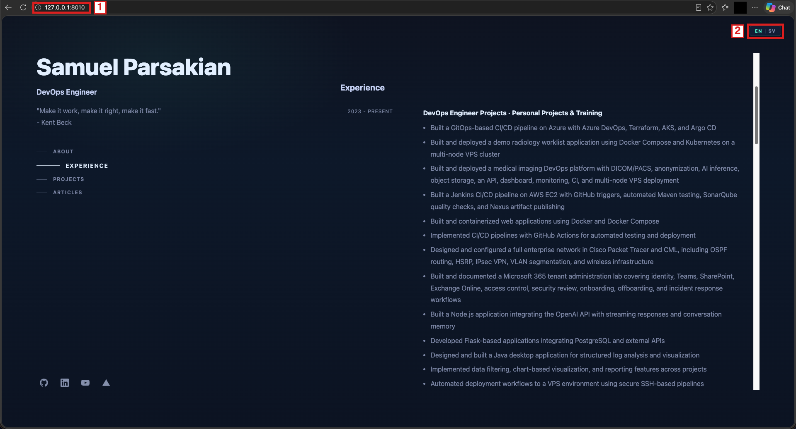

*Figure 6. The home page in English, running on the Mac.*

After a click on SV, the same page is shown in Swedish (Figure 7):

1. The address is still the local one.
2. SV is now the active language.
3. The headings are in Swedish, for example "Om mig" (About me).

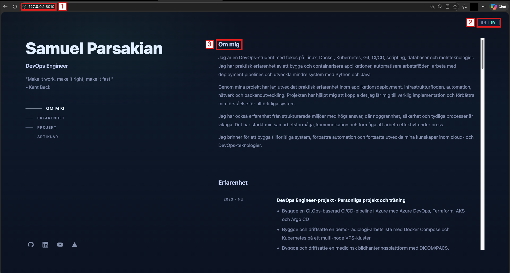

*Figure 7. The same home page in Swedish.*

### 2.2 The Live Server Today

The live site runs on a VPS (a rented virtual server) at Hetzner, with Ubuntu 24.04. Two programs work together on it:

- **Nginx** receives all visits to samparsa.se, handles HTTPS, and passes the requests on.
- **Gunicorn** runs the Django code. It is started by systemd, the part of Ubuntu that starts and watches services.

The command `systemctl status gunicorn --no-pager` shows if Gunicorn is running and from where (Figure 8):

1. The command asks systemd for the state of the Gunicorn service.
2. Gunicorn is active and has been running for 5 days.
3. It runs the site from the folder `/var/www/samstack_next4`, one of the 9 app folders from section 1.1.
4. The Gunicorn version is 24.1.1.

*Figure 8. Gunicorn runs the live site from the folder samstack_next4.*

The command `grep -E "server_name|proxy_pass|alias" /etc/nginx/sites-available/samparsa` shows only the three most important lines of the Nginx settings for the site (Figure 9):

1. `server_name`: Nginx answers for samparsa.se and www.samparsa.se.
2. `alias`: the static files are read straight from the same folder, samstack_next4.
3. `proxy_pass`: all other requests are passed to Gunicorn on port 8001 of the server itself.

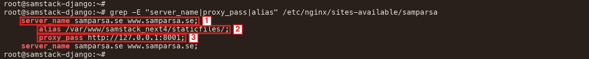

*Figure 9. Nginx passes visits to Gunicorn and serves the static files from samstack_next4.*

Both Gunicorn and Nginx point at one folder by its name. To put a new version live by hand, both must be changed and restarted, which is exactly the kind of manual step the pipeline removes.

Finally, the live site answers on its real address (Figure 10):

1. The address is https://samparsa.se, served over HTTPS.

*Figure 10. The live site at samparsa.se, the version that runs today.*

The website runs on the Mac without problems, in both languages, and the live server runs the same site through Nginx and Gunicorn. This is the starting point the pipeline is built on.

## 3. Continuous Integration: Every Change Is Checked Automatically

With the starting point clear, the first part of the pipeline can be built: Continuous Integration (CI). CI means that every change is checked automatically as soon as it is pushed, so mistakes are found early, while they are still small and cheap to fix.

### 3.1 The Repository: One Place for All Changes

**What was done.** The project was put under version control with Git and pushed to a new private repository on GitHub, `portfolio-cicd`.

**Why it was needed.** Before, the only copies of the site were on the Mac and in the folders on the server. A pipeline needs one shared place where every change arrives, so that it can react to each change.

**What it solves.** Every change now has a commit: who changed what, when and why. This is the base of traceability: later, every Docker image and every deployment can be traced back to a commit.

The repository is connected and the code is pushed from the terminal (Figure 11):

1. `git remote add origin ...` tells Git where the GitHub repository is.
2. `git push -u origin main feature/foundation` sends the two branches to GitHub.
3. GitHub confirms that both branches were created.

*Figure 11. The code is pushed to the new repository.*

The repository on GitHub then shows the code (Figure 12):

1. The repository `portfolio-cicd` is private.
2. Two branches: `main`, the stable version, and `feature/foundation`, where the first work was done. New work always happens on its own branch and is merged into `main` only when it is finished.
3. The latest commit on `main`, with its short ID (`2ec7ead`). This ID is how a version is identified later.
4. A short description of the project.

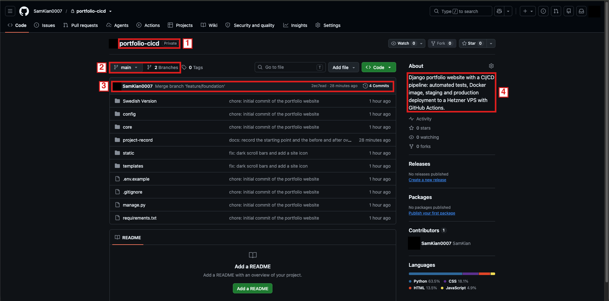

*Figure 12. The private repository on GitHub with the code and its history.*

### 3.2 What Is Tested: The Tests

The goal of the tests in `core/tests.py` is to prove, after every change, that the whole site still works: every page opens in both languages, the language switch works and cannot be misused, project pages show their own screenshots, and a wrong address answers "not found" instead of crashing the server. Before, the only check was to open a few pages in a browser by hand, which was slow, easy to skip and never complete. Now all 74 pages are checked automatically, so a broken page is stopped before it reaches the live site. The tests use Django's own test tools, so no extra framework is needed. Each test requests a page and compares the real answer with the expected one: the status code must be 200, the Swedish page must contain the heading "Om mig", the language switch must lead back to `/`. Any difference fails the test. The requests go straight to the Django code in memory, with no browser, network or database, which is why all 10 tests finish in well under a second.

The start of the file prepares the list of pages (Figure 13):

1. A short description of what the file does. The site has no database, so every test is a `SimpleTestCase`, the lightest kind of Django test.
2. `PROJECTS_WITH_PAGES` finds every project that has screenshots, because only those have a detail page and a gallery page.
3. `all_page_urls()` builds the full list of addresses: the main pages, the articles, and each project's detail and gallery pages. That is 37 addresses.

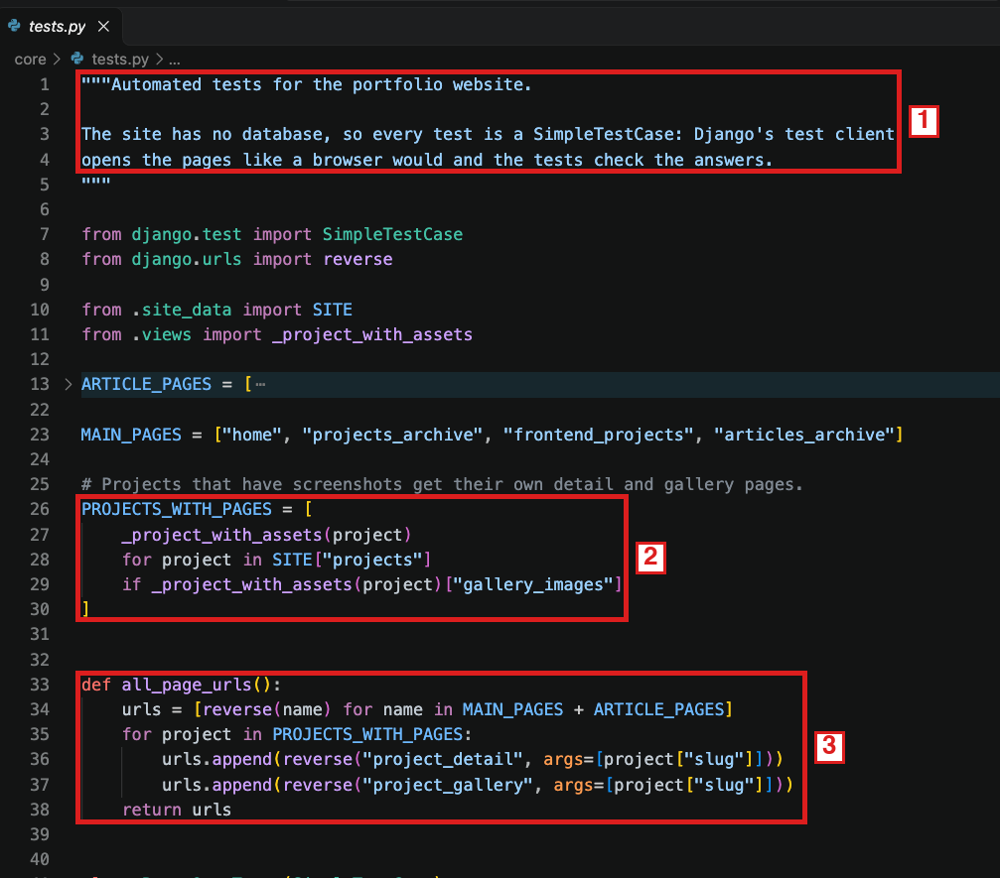

*Figure 13. `core/tests.py`, part 1: the list of every page on the site.*

The first two groups of tests check the pages and the language switch (Figure 14):

1. Every one of the 37 pages must open in English with status 200.
2. The same test runs again with the language cookie set to Swedish. Together that is 74 pages.
3. The switch to Swedish must send the visitor back to the page they came from and save the choice in a cookie.

*Figure 14. `core/tests.py`, part 2: every page in both languages, and the language switch.*

The next tests check the Swedish text and the safety of the switch (Figure 15):

1. After the switch, the home page must really be in Swedish, with the heading "Om mig".
2. The switch must never send a visitor to another website, even if someone builds a link that asks for it. This becomes important in section 3.4.
3. A project page must show the project's own screenshots.

*Figure 15. `core/tests.py`, part 3: Swedish text, a safe language switch and the project images.*

The last group checks what happens with a wrong address (Figure 16):

1. An unknown page and an unknown project must answer 404 (not found). If they answered 500, it would mean that the server crashed.

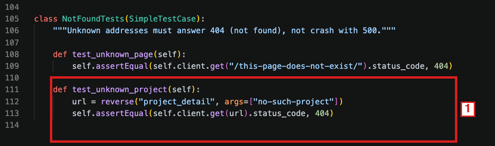

*Figure 16. `core/tests.py`, part 4: wrong addresses answer "not found".*

### 3.3 How the Pipeline Is Configured: The Tools and the Workflow

**What was done.** Three check tools were chosen and a GitHub Actions workflow was written that runs them, together with the tests, on every push.

**Why it was needed.** Tests check that the site works. They do not check code quality or security. Each tool covers one more kind of risk.

**What it solves.** Problems in style, in the packages and in the production settings are found before anything is deployed.

| Tool | What it checks | Risk it reduces |
|---|---|---|
| `ruff` (lint) | Code style and common mistakes, for example an unused import | Messy code that hides real bugs |
| `pip-audit` | The Python packages in `requirements.txt` against a public list of known security holes | Running a package that attackers already know how to break |
| `bandit` | The project's own code for risky patterns, for example a password written in the code | Security mistakes in the code itself |
| `manage.py check --deploy` | Django's own check of the production settings | A live site with unsafe settings, for example debug mode left on |

The packages the website needs are listed with exact versions in `requirements.txt` (Figure 17):

1. Django, the framework, at version 5.2.10. This exact version becomes important in section 3.4.
2. django-environ reads the settings from the environment, and WhiteNoise serves the static files.

*Figure 17. `requirements.txt`: the exact package versions the website runs on.*

The check tools are kept in a separate file, `requirements-dev.txt`, because the live website does not need them (Figure 18):

1. The line `-r requirements.txt` includes the website's own packages, so the tests run against exactly the same versions.
2. The three check tools, each with an exact version, so the checks behave the same on every run.

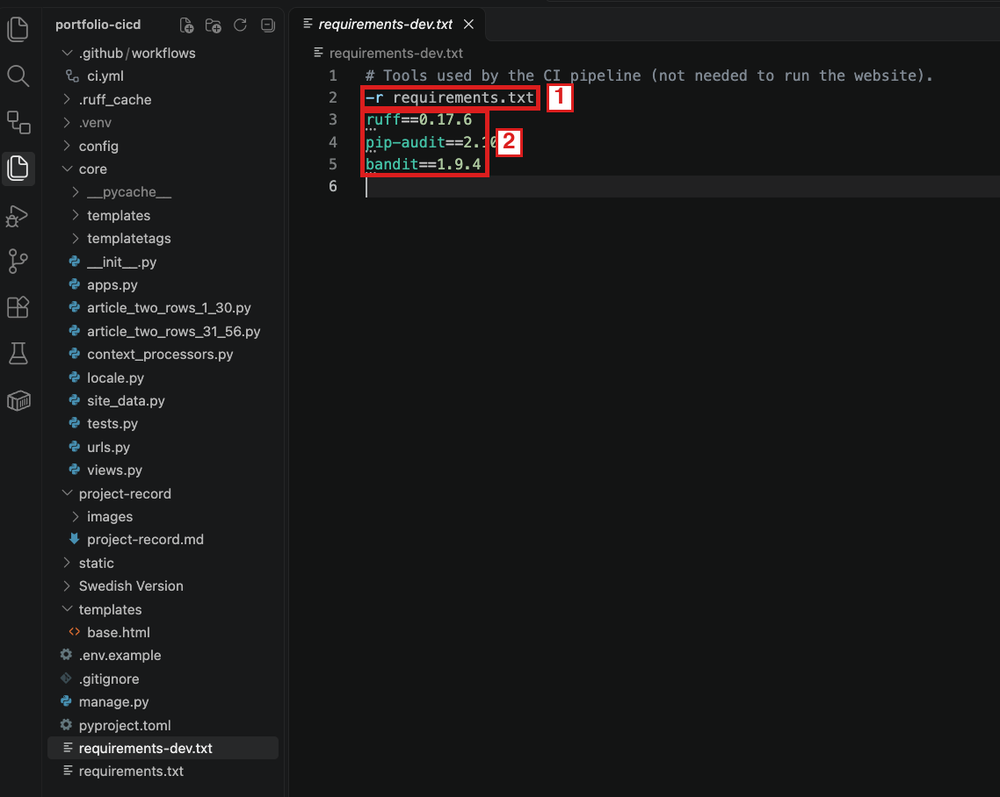

*Figure 18. `requirements-dev.txt`: the tools used only by the pipeline.*

A GitHub Actions workflow is a file in `.github/workflows/` that tells GitHub what to run and when. GitHub starts a fresh Ubuntu machine (a "runner") for each job, runs the steps, and throws the machine away afterwards. The first part of `ci.yml` sets the rules and the first job (Figure 19):

1. `on: push` and `pull_request`: the workflow runs on every push to any branch and on every pull request.
2. `permissions: contents: read`: the workflow may only read the code. It cannot change anything in the repository, which limits the damage if a tool were ever compromised.
3. Python 3.11 is installed, the same version as on the Mac. `cache: pip` keeps the downloaded packages between runs, so later runs are faster.
4. The lint job runs `ruff check .` on the whole project.
5. The test job starts. Each job runs on its own fresh machine.

*Figure 19. `.github/workflows/ci.yml`, part 1: when the workflow runs, and the lint job.*

The rest of the file holds the test job and the security job (Figure 20):

1. `collectstatic` gathers all static files, the same step the live server needs. If a file were missing, this step would fail.
2. `python manage.py test` runs all the tests from section 3.2.
3. `pip-audit` checks the website's packages for known security holes.
4. `bandit` checks the code in `core` and `config` for risky patterns.
5. Django's deploy check runs with production settings: debug off, the real domain, and a random secret key made only for this run, so no real secret is ever stored in the workflow.

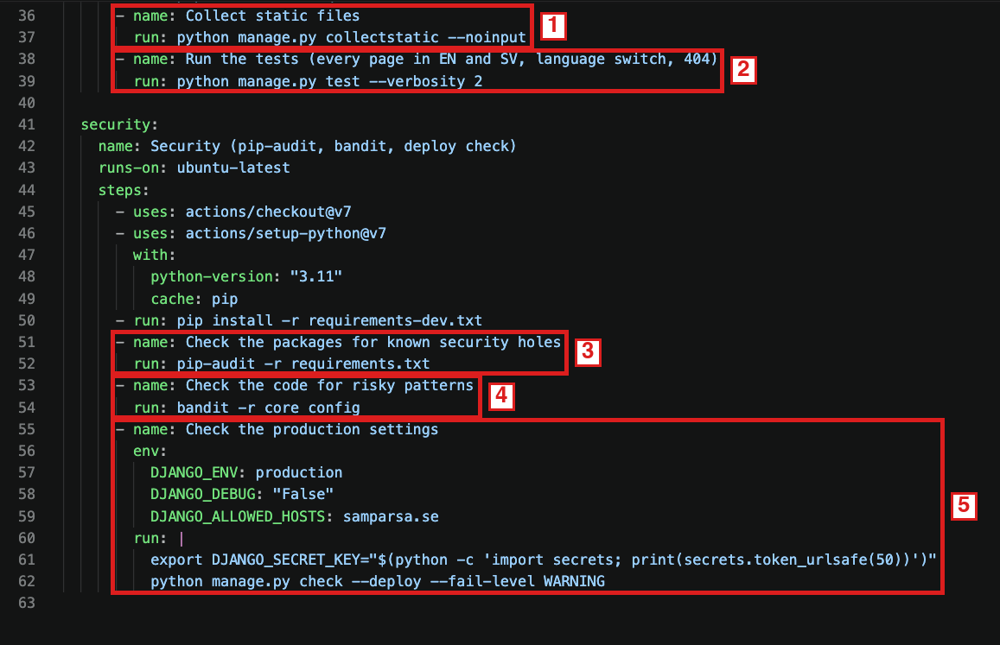

*Figure 20. `.github/workflows/ci.yml`, part 2: the test job and the security job.*

The three jobs (lint, tests, security) run side by side. This is faster than one long job, and when a run fails, the red job shows at once which kind of check found the problem.

### 3.4 The First Run: The Pipeline Finds Real Problems

The workflow ran for the first time as soon as it was pushed. All three jobs failed. The problems were already in the code and packages of the live website. They had simply never been checked before.

The summary of the run shows the result at a glance (Figure 21):

1. The run was started by a push of commit `940b020` to the branch `feature/ci`. This link between a run and a commit is what makes every result traceable.
2. Status: Failure, after 38 seconds.
3. All three jobs are red. Because they run side by side, each one reports its own problem.
4. Each job ends with "exit code 1", which is how a tool tells GitHub that its check failed.

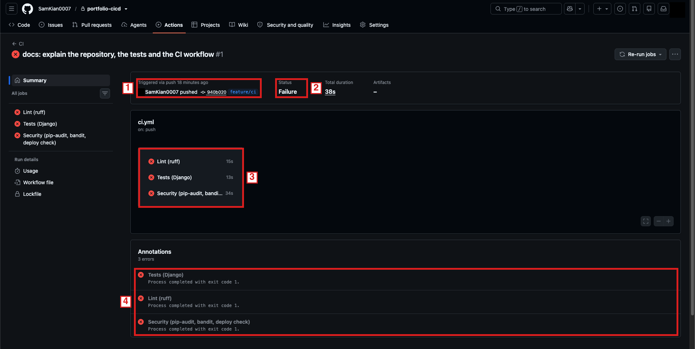

*Figure 21. The first run of the workflow: all three jobs failed.*

**Lint: 8 code style problems.** Ruff listed every problem with the file, the line and a suggested fix (Figure 22):

1. The failed step, "Check code style and common mistakes".
2. One of the problems: `get_ui` is imported in `core/views.py` but never used. Ruff also shows the fix: remove it from the import line.
3. "Found 8 errors". Six of them ruff can fix by itself, marked `[*]`.

*Figure 22. The lint job: ruff found 8 problems in the code.*

**Tests: the language switch could send visitors to another website.** Nine of the ten tests passed. The failing one is the safety test from section 3.2 (Figure 23):

1. The failed step, "Run the tests".
2. The other tests passed, so every page opens in both languages.
3. The failure: the test expected the switch to lead back to `/`, but it led to `//other-site.example/`. A link like that starts with `/`, so the old code accepted it as a page on this site, but a browser reads it as another website. Someone could use it to send a visitor from samparsa.se to a fake site. This kind of hole is called an open redirect.
4. "Ran 10 tests in 0.296s", "FAILED (failures=1)".

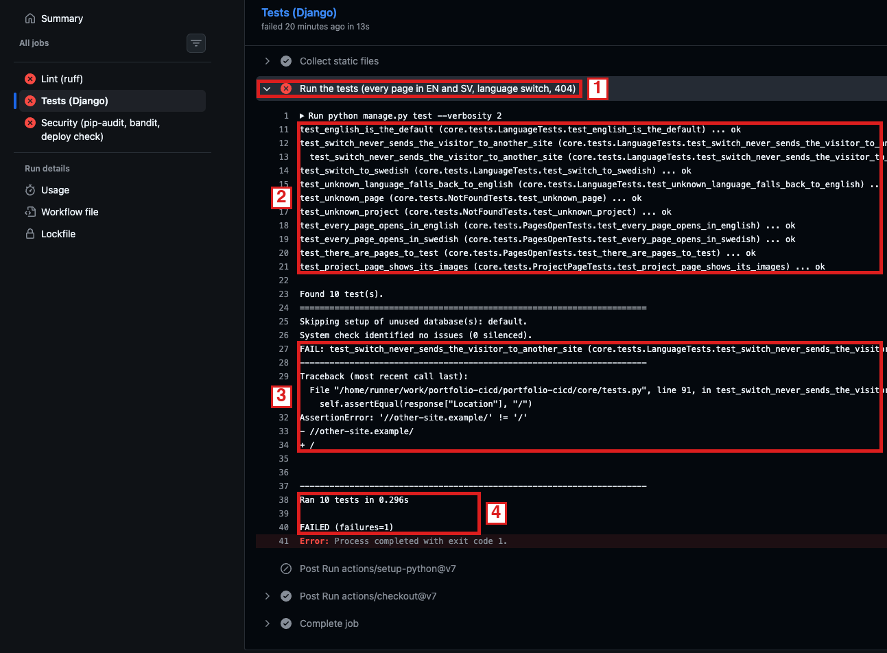

*Figure 23. The test job: the language switch failed the safety test.*

**Security: Django 5.2.10 had known security holes.** pip-audit compared the installed packages with a public list of known security holes (Figure 24):

1. The failed step, "Check the packages for known security holes".
2. The end of the list. In total, pip-audit reported "Found 51 known vulnerabilities in 1 package", all in Django 5.2.10. The last column shows the versions where each hole is fixed.
3. Because this step failed, the next two checks (bandit and the deploy check) did not run at all.

*Figure 24. The security job: pip-audit found known security holes in Django 5.2.10.*

### 3.5 Fixing the Findings: One Fix for Each Problem

Each finding from section 3.4 got its own small fix, in its own commit, so every change can be traced back to the problem it solves.

**Problem 1: code style.** Ruff found 8 problems. *Solution: follow ruff's suggestions.* Six of the fixes were the ones ruff offered itself (Figure 22): imports sorted in four files, the unused `get_ui` import removed, and an old comment marker that was no longer needed. The last two were changed by hand: a loop in `core/locale.py` now reads only the values it uses, and a too-broad `except Exception` in `core/templatetags/locale_extras.py` now catches only the two errors that can really happen there (`TypeError`, `ValueError`). The behavior of the site did not change.

**Problem 2: the open redirect.** The switch trusted any address that started with `/`. *Solution: use Django's own safety check.* Instead of a home-made rule, the switch now asks Django whether the address really belongs to this site (Figure 25):

1. The check is imported from Django: `url_has_allowed_host_and_scheme`.
2. If the address points anywhere other than this site, the visitor is sent to the home page `/` instead.

*Figure 25. `core/views.py`: the language switch now only goes back to pages on this site.*

**Problem 3: known security holes in Django.** *Solution: update Django to the latest 5.2 version.* Version 5.2.19 fixes all the reported holes. It is still in the same 5.2 series, a long-term support version, so the update brings fixes but no breaking changes (Figure 26):

1. `Django==5.2.19` instead of `5.2.10`.

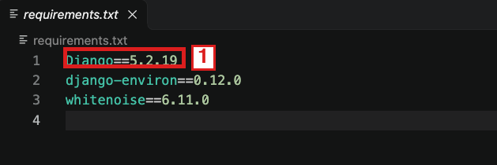

*Figure 26. `requirements.txt`: Django updated to 5.2.19.*

Before pushing, the same checks were run on the Mac: ruff reported "All checks passed!", all 10 tests passed, pip-audit reported "No known vulnerabilities found", and the deploy check found no issues.

### 3.6 The Second Run: Green, and Only Green Code Reaches main

After the three fixes were pushed, the workflow ran again by itself. The list of runs now tells the whole story (Figure 27):

1. Run #1, commit `940b020`: failed.
2. Run #2, commit `9c2c9cf`, the Django update: passed.

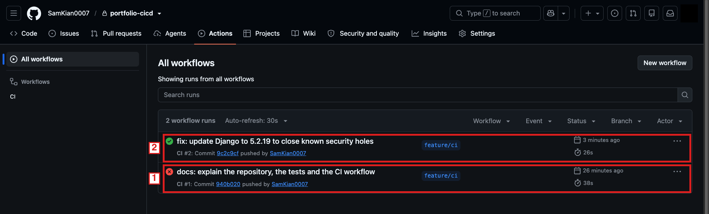

*Figure 27. The list of runs: the first run failed, the run after the fixes passed.*

The second run in detail (Figure 28):

1. Started by the push of commit `9c2c9cf` to `feature/ci`.
2. Status: Success, after 26 seconds.
3. All three jobs are green: lint 15 s, tests 10 s, security 23 s.

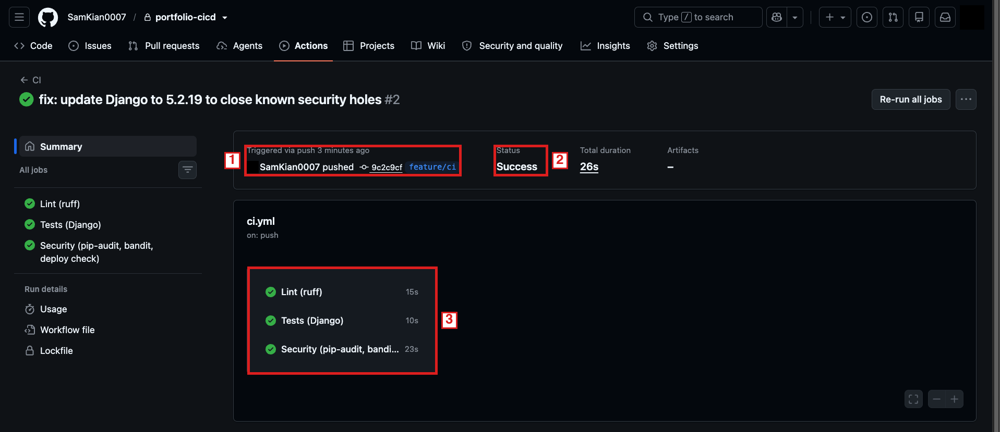

*Figure 28. The second run: all three checks passed.*

A green run only helps if a red one can actually stop a change. Without a rule, anyone could still merge broken code into `main`. So a branch protection rule was added to `main` in the repository settings. It allows changes only through a pull request, and only when all three checks have passed (Figure 29):

1. "Require status checks to pass before merging" is turned on.
2. The three required checks: `Lint (ruff)`, `Tests (Django)` and `Security (pip-audit, bandit, deploy check)`. If any of them is red, the merge button stays locked.

*Figure 29. The branch protection rule: `main` only accepts changes that passed all three checks.*

No approval from a second person is required, because there is only one developer. The rule still makes sure that every change is checked before it reaches `main`, and later, before it reaches the server.

Continuous Integration is now in place. Every push is checked for code style, broken pages, unsafe redirects, known security holes and unsafe production settings, in under a minute. The first run already found three real problems in the live site, and all three were fixed and confirmed by a green run.
